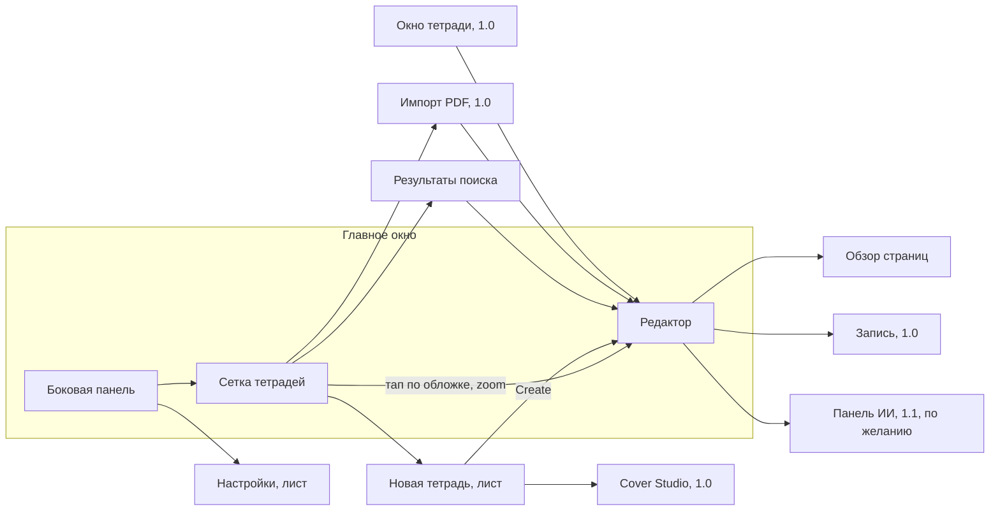
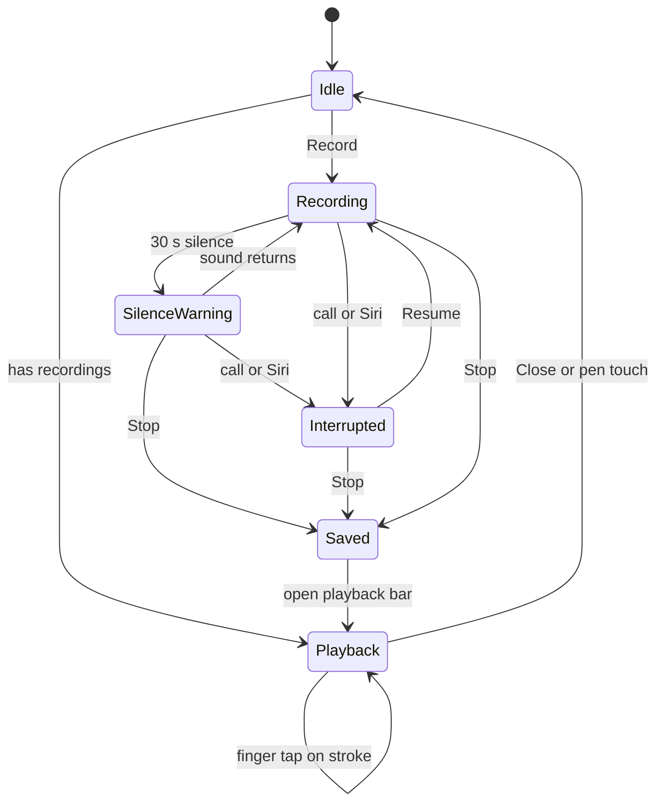
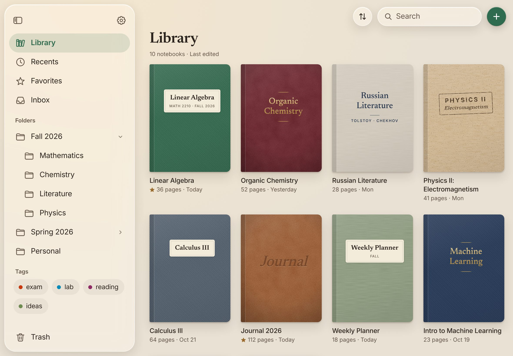
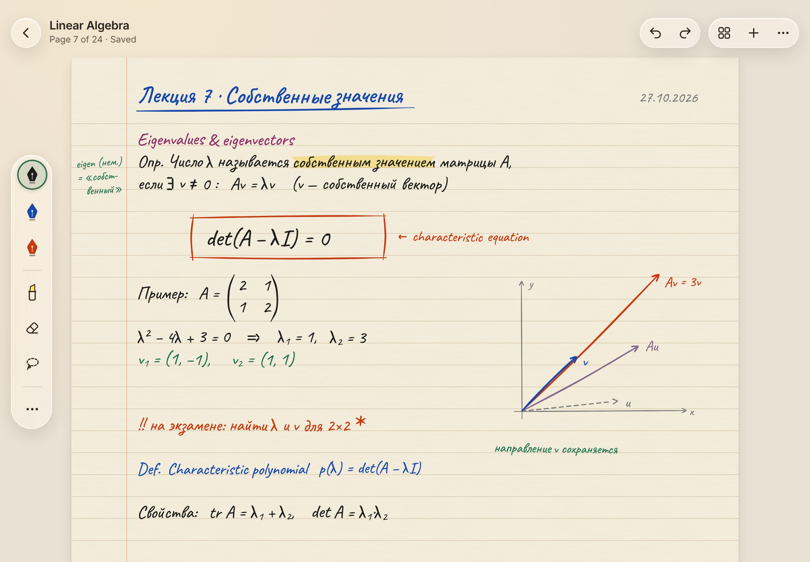
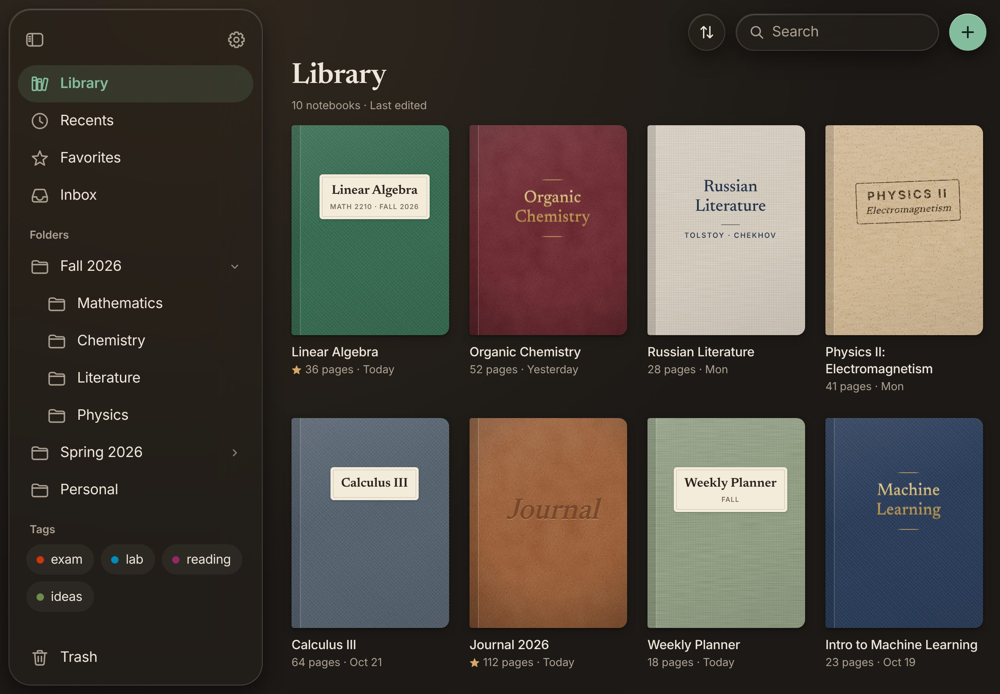
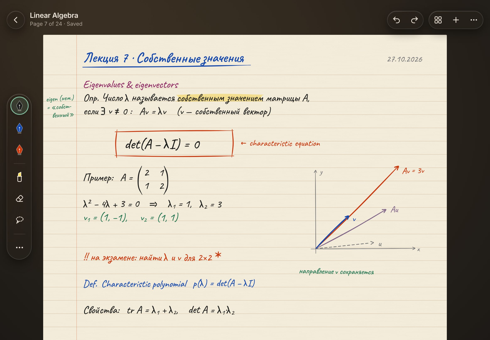
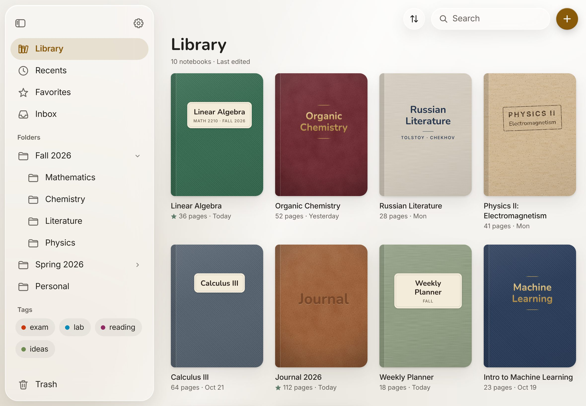
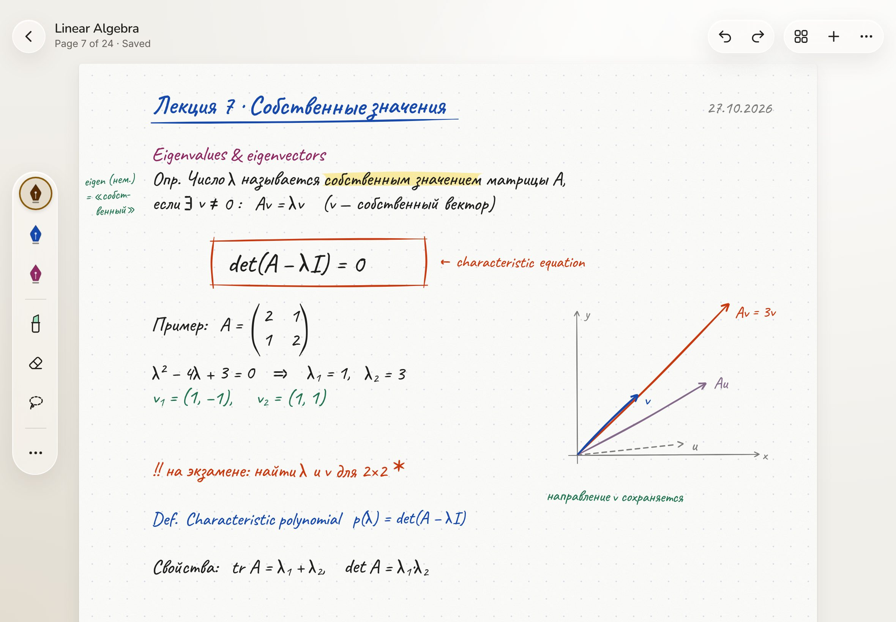
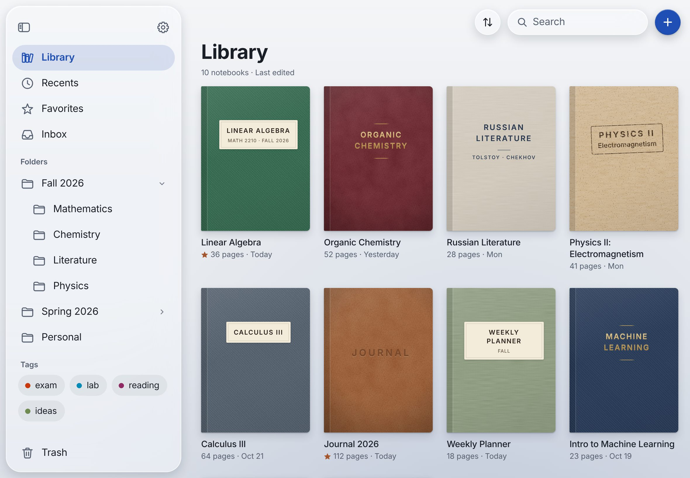
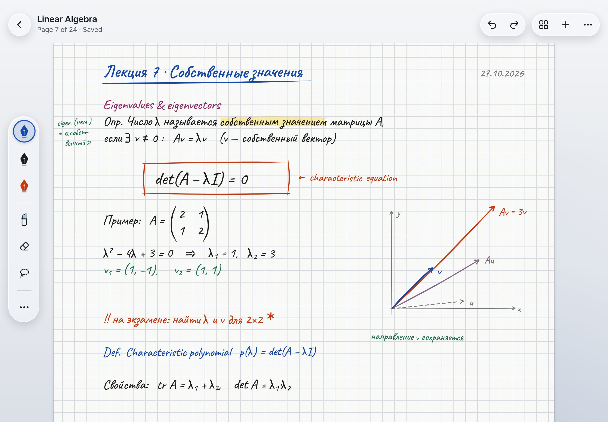

# Product Proposal — Часть 2. Дизайн

> Черновик для обсуждения, 27.10.2026. Рабочее название — **Carrel**. Метки релизов **MVP**, **1.0** и **Future** — как в [части 1](01-product.md); ИИ-функции выходят в 1.1, первом релизе после 1.0. Минимальная система — iPadOS 27.
>
> Контраст посчитан по формуле WCAG 2.x. Различимость чернил оценена моделированием дальтонизма (Machado et al., 2009, полная выраженность) и метрикой CIEDE2000. Поведение iPadOS, которое не подтверждено документацией, помечено словом «проверить» вместе со способом проверки.

## 6. UI/UX-концепция

### 6.1 Принципы дизайна

Споры между принципами решает порядок приоритетов владельца: UX, сохранность данных, эстетика, скорость, простота архитектуры, масштабируемость.

**1. Бумага первая.**
HIG строит интерфейс iPadOS вокруг контента, над которым плавает слой управления. Наш контент — страница. Во время письма видны бумага, край стола, верхняя панель и узкая палитра. Палитра стоит на поле стола, верхняя панель — над полосой стола, и страница под неё не уходит (см. [«Редактор»](#редактор) в 6.5).
*Проверка:* в режиме письма на бумаге нет ни одного элемента управления; элементы управления занимают не больше 8% площади окна; в масштабе «по ширине» бумага занимает всю ширину между полями стола. Площадь считаем по контурам самих элементов (капсула палитры, кнопки и блок названия верхней панели) на скриншоте редактора iPad Air 11" в альбомной ориентации во весь экран. Тот же критерий — в принципе 1 из [2.2](01-product.md#22-принципы).

**2. Стекло — только слой управления.**
Liquid Glass получают системные панели, листы и поповеры, плюс наши плавающие элементы управления: палитра инструментов, палитра у кончика пера, капсула записи, полоса воспроизведения, баннер прерывания записи, временные пузыри масштаба и номера страницы, в 1.0 — кнопка Color у выделения. Страница, обложки, миниатюры и результаты поиска — слой контента, и стекла там нет. Это прямое правило HIG: «Don't use Liquid Glass in the content layer».
Во время письма в покое над бумагой нет стекла. Временные элементы, вызванные пользователем (палитра у кончика пера, полоса воспроизведения, баннер прерывания записи), могут лежать над бумагой и убираются сами.
*Проверка:* для любого стеклянного элемента на экране можно назвать действие, которое он выполняет; на скриншоте пишущего человека над бумагой нет ни одного стеклянного элемента.

**3. Тихо по умолчанию.**
Нет бейджей, счётчиков, обучающих туров и окон What's New. Информация появляется, когда нужна, и уходит сама; подсказок — не больше одной за сеанс. Громким бывает только то, что угрожает данным: ошибка сохранения видна, пока её не решат.
*Проверка:* если открытую тетрадь не трогать 10 минут, на экране не появится ни одного нового элемента.

**4. Движение объясняет состояние.**
Каждая анимация отвечает на вопрос «откуда это пришло и куда ушло»: тетрадь раскрывается из своей обложки, новая страница проявляется на месте контура под последней. Декоративных циклов нет. Пока перо на странице, интерфейс неподвижен: индикатор уровня в капсуле записи на это время приглушается и не меняет ни размера, ни цвета (исключения перечислены в [6.7](#67-движение-и-анимации)).
*Проверка:* при Reduce Motion та же информация передаётся затуханием, и ничего не теряется.

**5. Красота не спорит с удобством.**
У каждого декоративного решения есть доступный вариант. Цвета интерфейса проходят WCAG AA, чернила различимы при дальтонизме, текстура бумаги не мешает читать, а под каждой обложкой есть читаемая подпись.
*Проверка:* таблицы контраста в 6.2; ни одно состояние не передаётся только цветом.

**6. Система раньше своего.**
Используем стандартные `NavigationSplitView`, листы, меню, `.searchable`, системные настройки Apple Pencil и жесты iPadOS. Своё делаем там, где оно и есть продукт: палитра, обложки, бумага, движение. Системные жесты не перехватываем; единственное исключение — жесты правки тремя пальцами на холсте ([6.6](#66-apple-pencil-и-жесты)).
*Проверка:* человек, знакомый с Заметками и Файлами, разбирается без подсказок.

**7. Ладонь на странице — не нажатие.**
Защита от ладони работает для рисования, но не для кнопок. Поэтому в зоне ладони — внизу справа у правши, внизу слева у левши — нет ни одного элемента управления, а режим для левой руки зеркалит палитру.
*Проверка:* за час письма на лекции — ни одного случайного нажатия (журнал внутреннего тестирования).

### 6.2 Настроения

Настроение — это набор токенов: цвета (asset catalog с вариантами Any, Dark и High Contrast), шрифты, формы, тени и правила стекла. Экраны обращаются к ролям (`desk`, `surface`, `accent`), а не к конкретным цветам. Поэтому новое настроение — это новые значения токенов без правок в экранах, и именно это делает настроения дешёвой персонализацией в 1.0.

**Бумага и чернила в настроение не входят.** Их цвет — содержимое тетради: он хранится в данных, попадает в экспорт PDF и должен одинаково выглядеть на другом iPad. Если бы настроение перекрашивало бумагу, экспорт зависел бы от темы интерфейса, а смена настроения меняла бы уже написанные конспекты. Поэтому бумага и палитра чернил общие для всех настроений, а настроение задаёт только бумагу и перья по умолчанию для новых тетрадей.

#### Общие токены содержимого

| Тон бумаги | Фон | Линии и точки (`ruleLine`) | Линия поля (`marginLine`) | Релиз | Зачем |
|---|---|---|---|---|---|
| White | `#FCFCFA` | `#D5DCE6` | `#EDC1B3` | MVP | Белый без резкости `#FFFFFF`; точнее всего передаёт цвет чернил |
| Cream | `#F6EEDC` | `#DCCFB5` | `#E9B79E` | MVP | Тёплая бумага для длинных лекций и дневника |
| Linen | `#ECE8E0` | `#D3CCBF` | `#E2B3A1` | 1.0 | Приглушённая серо-бежевая, меньше бликует при ярком свете |
| Night | `#22211F` | `#3A3835` | `#5B3931` | 1.0 | Тёмная бумага для вечера |

Типы бумаги: Blank; Ruled — узкая и широкая линейка; Ruled with Margin — та же линейка с вертикальной линией поля слева в 50 pt (около 18 мм) от края, как в школьной тетради; Grid — клетка 5 мм; Dots — точки 5 мм. Все пять входят в MVP: поле — одна линия в том же фоновом слое, что и линовка, а на полях удобно ставить номера задач и короткие пометки.

Линии и точки намеренно слабые (контраст около 1.3:1), чтобы не спорить с почерком. Линия поля — Vermilion на 30% поверх тона бумаги (около 1.6:1): она делит страницу и не теряется, но остаётся тише любых чернил (у них не меньше 3:1). При Increase Contrast линии и линия поля темнеют. Линовку рисуем сами в фоновом слое под холстом: она не попадает в данные PencilKit и меняется вместе с типом бумаги.

Палитру чернил подбирали перебором. Цель — максимальное минимальное попарное различие ΔE00 одновременно при обычном зрении, протанопии, дейтеранопии и тританопии, при контрасте не ниже 3:1 на любой светлой бумаге (WCAG 1.4.11 для нетекстовых элементов).

| Чернила | Hex | На White | На Cream | На Linen | Роль по умолчанию |
|---|---|---|---|---|---|
| Carbon | `#1E1E1C` | 16.3 | 14.5 | 13.7 | Основной текст |
| Ink Blue | `#1649AE` | 7.9 | 7.0 | 6.6 | Основной текст, заголовки |
| Sky | `#008CBA` | 3.7 | 3.3 | 3.2 | Схемы, второстепенное |
| Green | `#1F744F` | 5.6 | 5.0 | 4.7 | Примеры |
| Moss | `#6E8B50` | 3.7 | 3.3 | 3.1 | Схемы, пометки |
| Vermilion | `#CB380D` | 5.0 | 4.4 | 4.2 | Важное, исправления |
| Plum | `#912964` | 7.6 | 6.7 | 6.4 | Определения, термины |
| Lavender | `#84698B` | 4.7 | 4.2 | 3.9 | Пометки на полях |
| Sepia | `#562B05` | 11.7 | 10.4 | 9.9 | Дневник, тёплый текст |
| Graphite | `#7A7A7A` | 4.2 | 3.7 | 3.5 | Оси, сетки, черновое |

- Минимальное ΔE00 между любыми двумя чернилами: 15.9 при обычном зрении, 11.6 при протанопии, 10.9 при дейтеранопии, 11.8 при тританопии. Различие около 10 и выше читается как «явно другой цвет».
- Оранжевого среди чернил нет сознательно. При контрасте, достаточном для письма, он сливается с Vermilion при дейтеранопии: во всех опробованных вариантах ΔE00 было 5–9.
- Цвет никогда не единственный признак: у каждого пера есть имя в палитре, в VoiceOver и в подсказке при наведении указателя.
- Highlighter (полупрозрачные чернила `marker` в PencilKit): Yellow `#FFE45C`, Blue `#8CCBF2`, Pink `#F4A6C8`, Mint `#9FE2BF`. Минимальное ΔE00: 8.5 при протанопии и 10.2 при дейтеранопии; слабее всего пара Blue/Mint при редкой тританопии — 6.5.
- Свой цвет пера задаётся в настройках пера системным пикером цвета (см. [«Редактор»](#редактор) в 6.5). Проверку контраста и различимости проходит только готовая палитра; за свой цвет отвечает тот, кто его выбрал.

**Бумага Night (1.0).** PencilKit хранит цвета чернил в светлом варианте и сам пересчитывает их для тёмного оформления (`PKInkingTool.convertColor(_:from:to:)`). Холсту на светлой бумаге задаём `overrideUserInterfaceStyle = .light` при любой теме приложения, на Night — `.dark`. Миниатюры рендерим с тем же флагом через `draw(in:frame:from:darkUserInterfaceStyle:)`. Night отложена до 1.0 именно из-за этого пересчёта: до включения тона проверяем пересчитанную палитру на устройстве — контраст не ниже 3:1 и та же различимость. Если проверка не пройдёт, Night получит свою палитру, а смена тона бумаги у существующей тетради будет идти с предупреждением.

#### Reading Room — рекомендуемое

Библиотечный стол-карел вечером: тёплый овсяный стол, кремовая бумага, зелёный акцент библиотечной лампы и латунь как второй акцент. Заголовки набраны New York — книжно, но без стилизации под старину.

| Роль | Светлая | Тёмная | Increase Contrast (светлая / тёмная) |
|---|---|---|---|
| Desk — фон приложения и поле вокруг страниц | `#E9E1D3` | `#1B1815` | — |
| Surface — листы, карточки, поля ввода | `#F8F3EA` | `#25211D` | — |
| Primary text | `#2B241E` | `#EEE6DA` | — |
| Secondary text | `#65584B` | `#ABA092` | `#4E4237` / `#CBC1B4` |
| Accent — выбор, основные действия | `#2F6B4F` | `#84BD9D` | `#22553D` / `#A6D6BA` |
| Secondary accent — избранное, индикаторы | `#9A6A2C` | `#D8A866` | — |
| On accent — текст на заливке акцента | `#FFFFFF` | `#14211A` | — |
| Separator | `#DDD2C2` | `#3A332C` | `#A89A86` / `#5E544A` |
| Destructive | `#B3261E` | `#F28B82` | `#8F1D17` / `#FFB1A9` |
| Shadow | `#3B2A1A` | `#000000` | — |

Бумага по умолчанию — Cream, Ruled with Margin с узкой линейкой. Перья по умолчанию — Carbon, Ink Blue, Vermilion; Highlighter — Yellow.

#### Studio

Светлая мастерская утром, японские канцтовары. Много воздуха, мягкие скругления, SF Pro Rounded в заголовках, медовый акцент и шалфей. Самое лёгкое из трёх настроений.

| Роль | Светлая | Тёмная |
|---|---|---|
| Desk | `#F1EFEA` | `#1A1A19` |
| Surface | `#FBFAF7` | `#242422` |
| Primary text | `#23211E` | `#F0EEEA` |
| Secondary text | `#66625B` | `#A9A59E` |
| Accent (honey) | `#8A5A0B` | `#E3B663` |
| Secondary accent (sage) | `#5F7D69` | `#9DBFA8` |
| On accent | `#FFFFFF` | `#261C08` |
| Separator | `#E3DFD8` | `#363532` |
| Destructive | `#B3261E` | `#F28B82` |
| Shadow | `#403A33` | `#000000` |

Бумага по умолчанию — White в точку 5 мм. Перья — Sepia, Ink Blue, Plum; Highlighter — Mint.

#### Inkwell

Синие чернила и холодный вечер: чёткая геометрия, только SF Pro, малые радиусы, холодная контрастная гамма. Для тех, кому важнее собранность, чем уют.

| Роль | Светлая | Тёмная |
|---|---|---|
| Desk | `#E8EBEF` | `#11141A` |
| Surface | `#F5F7F9` | `#1A1E26` |
| Primary text | `#1A1E26` | `#E7EAF0` |
| Secondary text | `#576070` | `#9AA3B3` |
| Accent (ink blue) | `#1F4FB4` | `#8FB0FF` |
| Secondary accent (copper) | `#A4552B` | `#E3A27C` |
| On accent | `#FFFFFF` | `#0E1A33` |
| Separator | `#D3D8E0` | `#2B313C` |
| Destructive | `#B42318` | `#FF8A80` |
| Shadow | `#0E1626` | `#000000` |

Бумага по умолчанию — White в клетку 5 мм. Перья — Ink Blue, Carbon, Vermilion; Highlighter — Blue.

#### Контраст

Порог AA для обычного текста — 4.5:1. Все текстовые роли проходят его на обоих фонах в обеих темах.

| Настроение | Тема | Primary / Desk | Secondary / Desk | Primary / Surface | Secondary / Surface | Accent / Desk | Destructive / Desk | On accent / Accent |
|---|---|---|---|---|---|---|---|---|
| Reading Room | светлая | 11.8 | 5.3 | 13.8 | 6.2 | 4.9 | 5.0 | 6.3 |
| Reading Room | тёмная | 14.3 | 6.9 | 12.9 | 6.2 | 8.2 | 7.4 | 7.7 |
| Studio | светлая | 14.0 | 5.3 | 15.4 | 5.8 | 5.2 | 5.7 | 5.9 |
| Studio | тёмная | 15.0 | 7.1 | 13.4 | 6.3 | 9.2 | 7.3 | 8.9 |
| Inkwell | светлая | 14.0 | 5.3 | 15.6 | 5.9 | 6.2 | 5.5 | 7.4 |
| Inkwell | тёмная | 15.3 | 7.3 | 13.9 | 6.6 | 8.6 | 8.1 | 8.1 |

- Secondary accent используется только для графики (иконки, индикаторы) и держит не меньше 3:1 к Desk (минимум — 3.6 у Reading Room в светлой теме).
- Separator декоративный (1.2–1.4:1); при Increase Contrast он темнеет.
- Increase Contrast в Reading Room поднимает Secondary до 7.5:1 в светлой теме и 10.0:1 в тёмной (уровень AAA), Accent — до 6.6 и 10.9.
- Текст на стекле подбирает система. Проверяем его на iPadOS 27 при обоих крайних положениях ползунка Liquid Glass.

#### Типографика

Все шрифты системные, через `Font.system(_:design:weight:)`: `.serif` даёт New York, `.rounded` — SF Pro Rounded. Dynamic Type работает без дополнительного кода. Основной текст во всех настроениях — SF Pro: характер настроения живёт в коротких заголовках, а списки и настройки остаются максимально читаемыми.

| Роль | Text style (размер при Large) | Reading Room | Studio | Inkwell |
|---|---|---|---|---|
| Заголовок экрана | `.largeTitle` (34) | New York Semibold | SF Pro Rounded Semibold | SF Pro Bold |
| Заголовок раздела, пустое состояние | `.title2` (22) | New York Medium | SF Pro Rounded Semibold | SF Pro Semibold |
| Заголовок листа, имя тетради в редакторе | `.headline` (17) | SF Pro Semibold | SF Pro Rounded Semibold | SF Pro Semibold |
| Основной текст, строки списков, меню | `.body` (17) | SF Pro | SF Pro | SF Pro |
| Название под обложкой | `.subheadline` (15) | SF Pro Medium | SF Pro Rounded Medium | SF Pro Medium |
| Метаданные: страницы, дата, «Saved» | `.footnote` (13) | SF Pro, `monospacedDigit()` | SF Pro, `monospacedDigit()` | SF Pro, `monospacedDigit()` |
| Подписи инструментов | `.caption` (12) | SF Pro | SF Pro Rounded | SF Pro |
| Надпись на обложке | фиксирована, в пропорции к обложке | New York | SF Pro Rounded | SF Pro Semibold, `smallCaps()` |

Надпись на обложке — часть рисунка и с Dynamic Type не масштабируется. Поэтому название всегда продублировано подписью под обложкой: она масштабируется и её читает VoiceOver.

#### Формы

Скругления концентрические: внутренний радиус равен внешнему минус отступ. Внутри стеклянных контейнеров и листов используем `ConcentricRectangle`, и чипы палитры и карточки в листах автоматически повторяют форму контейнера. Обложка имеет форму книги — почти прямой угол у корешка и скругление у обреза (`UnevenRoundedRectangle`).

| Элемент | Reading Room | Studio | Inkwell |
|---|---|---|---|
| Обложка: корешок / обрез, pt | 3 / 10 | 8 / 16 | 2 / 6 |
| Страница на столе | 2 | 4 | 1 |
| Миниатюра страницы | 4 | 8 | 3 |
| Плитка папки, карточка в листе | 14 | 20 | 10 |
| Палитра и кнопки на стекле | Capsule | Capsule | Capsule |
| Элементы внутри стекла | `ConcentricRectangle` | `ConcentricRectangle` | `ConcentricRectangle` |

#### Высота и тени

Тени записаны как «смещение y / размытие / непрозрачность»; цвет берётся из токена Shadow. В SwiftUI `shadow(radius:)` примерно равен половине размытия. В прокручиваемых сетках тень задаём через `shadowPath` или заранее отрисованной картинкой, чтобы прокрутка не порождала лишних проходов рендера.

| Уровень | Где | Reading Room | Studio | Inkwell |
|---|---|---|---|---|
| 0 | Стол | — | — | — |
| 1 | Страница на столе | 1/2/18% + 6/16/10% | 1/2/10% + 8/24/8% | обводка 0.5 pt 12% + 2/6/12% |
| 2 | Обложка в сетке | 2/3/22% + 12/24/14% | 2/4/14% + 14/32/10% | 1/2/25% + 6/14/14% |
| 3 | Поднятый объект при перетаскивании | 18/36/22% | 20/40/14% | 12/24/24% |
| — | Стекло | системная тень, свою не добавляем | то же | то же |

В тёмной теме тени почти не видны. Обложки отделяет светлая линия 0.5 pt (белый, 8%) по верхнему краю, светлой бумаге на тёмном столе тень не нужна, бумага Night получает обводку 1 pt (белый, 8%).

#### Стекло

- Во всех настроениях палитры и панели используют `.regular` без тона. Стекло само берёт цвет у того, что под ним, поэтому тёплый стол Reading Room даёт тёплое стекло, а Inkwell — холодное, без отдельной настройки.
- Тон стекла несёт смысл, а не украшение (HIG): основное действие — `.glassProminent` с цветом Accent (кнопки «+», Create, Import), выбранный инструмент — `.regular.tint(accent)`. Цвета тона: Reading Room `#2F6B4F` / `#84BD9D`, Studio `#8A5A0B` / `#E3B663`, Inkwell `#1F4FB4` / `#8FB0FF`.
- `.clear` не используем: под нашими элементами управления нет насыщенных медиа, ради которых он существует.
- Проверить: какой цвет подписи система выбирает на prominent-стекле со светлым тоном тёмной темы. Если контраст ниже 4.5:1, задаём подпись токеном On accent.

#### Рекомендация: Reading Room

- **Говорит то же, что имя.** Carrel — стол в библиотеке; лампа, дерево и бумага дают визуальный язык без иллюстраций и декора.
- **Уют цветом, а не украшениями.** Тёплый стол и кремовая бумага создают атмосферу, при этом интерфейс остаётся минимальным.
- **Тёмная тема — лампа ночью.** Это поддерживает вечернюю учёбу и дневник, второй по важности сценарий.
- **Акцент не спорит с чернилами.** Самые частые чернила — чёрные, синие и красные. Зелёное кольцо выбора вокруг синего пера читается однозначно; у Inkwell синий акцент вокруг Ink Blue сливается.
- **Характер без потери читаемости.** New York только в заголовках; списки, настройки и метаданные набраны SF Pro.
- **Риски.** Зелёный акцент и красный Destructive близки при дейтеранопии, поэтому разрушительные действия всегда подписаны и имеют `role: .destructive`. Тёплая гамма кому-то покажется старомодной — для них в 1.0 есть Studio.

Studio и Inkwell остаются вариантами настроения в 1.0 (пункт «Настроения приложения» в [4.9](01-product.md#49-персонализация)): это только значения токенов, и их стоимость — проверка контраста и скриншотов.

### 6.3 Сетка, отступы, размеры

**Шкала отступов** кратна 4 pt. В коде это именованные токены; отступы рядом с текстом масштабируются через `@ScaledMetric`.

| Токен | pt | Где |
|---|---|---|
| `xxs` | 4 | Между чипами внутри палитры, между иконкой и подписью |
| `xs` | 8 | Между кнопками в стеклянной группе, от обложки до подписи |
| `s` | 12 | Внутренние отступы чипов и строк |
| `m` | 16 | Поля окна в узкой ширине, отступ палитры от края окна |
| `l` | 24 | Между колонками сетки, внутренние отступы листов |
| `xl` | 32 | Поля контента в широком окне, между рядами сетки |
| `xxl` | 48 | Между разделами библиотеки |
| `xxxl` | 64 | Верхний отступ пустых состояний |

**Цели касания** — не меньше 44 × 44 pt (HIG), включая чипы палитры. Видимый размер может быть меньше (кончик пера в палитре — 32 pt), но зона касания расширяется через `contentShape`. Между соседними целями в палитре — не меньше 4 pt. Указатель не примагничивается к кнопкам, поэтому эффект наведения показывает настоящую зону касания.

**Устройства** (размеры в точках, портретная ориентация):

| Устройство | Экран | Библиотека, альбомная | Библиотека, портретная | Редактор при масштабе «по ширине» |
|---|---|---|---|---|
| iPad mini (A17 Pro) | 744 × 1133 | Боковая панель 280 + 4 колонки | Панель скрыта, 3 колонки | Страница ≈ 950 pt в альбомной, 590 в портретной |
| iPad Air 11", iPad Pro 11" | 820 × 1180, 834 × 1210 | Панель 300 + 4 колонки, обложка ≈ 190 pt | 4 колонки | ≈ 1000 / 660 pt |
| iPad Air 13", iPad Pro 13" | 1024 × 1366, 1032 × 1376 | Панель 320 + 5 колонок | 5 колонок | ≈ 1190 / 870 pt |

Масштаб страницы запоминается для каждой тетради отдельно; это состояние устройства, оно хранится вне пакета тетради и не синхронизируется ([8.4](03-architecture.md#84-модель-данных)). Страница хранится в точках PDF (A4 — 595 × 842), поэтому «по ширине» на 11" в альбомной ориентации — это примерно 1.7×. Крупный масштаб удобен для письма, но выбор пользователя важнее: изменённый масштаб тетрадь помнит.

**Брейкпоинты — по ширине окна, а не по модели iPad.** Перестройку навигации (`NavigationSplitView` → стек) делает система по size class; наша раскладка опирается на фактическую ширину.

| Ширина окна | Библиотека | Редактор |
|---|---|---|
| ≥ 1000 pt | Боковая панель рядом с сеткой | Вертикальная палитра на поле стола, страница между полями |
| 700–999 pt | Панель открывается поверх по кнопке | То же, поля уже |
| 500–699 pt | 2–3 колонки | Палитра становится горизонтальной капсулой в полосе стола под верхней панелью; область прокрутки начинается под палитрой, страница почти во всю ширину |
| < 500 pt | Панель свёрнута в стек (compact) | Палитра сворачивается в одну кнопку текущего инструмента и открывается поповером; Redo и обзор страниц уходят в меню More |

При высоте окна меньше 480 pt вертикальная палитра не помещается и тоже становится горизонтальной.

**Окна и разделение экрана.** Поддерживаем любой размер окна, `UIRequiresFullScreen` не ставим. Кнопки окна стоят слева вверху, и системная панель инструментов сама оставляет им место. В MVP окно одно (`UIApplicationSupportsMultipleScenes = NO`), но его размер меняется свободно. Заголовок окна — «Library» или имя тетради (в 1.0 у каждой тетради может быть своё окно). Типичный сценарий на паре — слайды в одной половине экрана, конспект в другой: окно шириной около 590 pt на 11". Там палитра горизонтальная, поля стола минимальные, а масштаб страницы — около 1×, что ещё удобно для письма. Окно восстанавливает свою тетрадь и страницу через `SceneStorage`.

**Ориентация.** Поддерживаем все четыре. При повороте сохраняется точка привязки: то, что было в центре видимой области, остаётся в центре. Положение палитры (сторона письма) сохраняется. Ориентацию не блокируем — для этого есть системный замок поворота.

### 6.4 Навигация и информационная архитектура



**Боковая панель** (`NavigationSplitView`, системное стекло):

- **Library** — все тетради, по умолчанию отсортированы по дате изменения.
- **Recents** — открытые за последние 14 дней, сгруппированные по дням: Today, Yesterday, This Week.
- **Favorites** — отмеченные звездой.
- **Inbox** — тетрадь для быстрых записей (создаётся автоматически).
- **Folders** — дерево «семестр → курс»; раскрытие через `DisclosureGroup`, тетрадь перетаскивается на папку.
- **Tags** (1.0) — теги тетрадей и страниц.
- **Trash** — последним пунктом, отдельно от остальных. Два раздела: Notebooks и Pages — удалённые страницы попадают сюда же, с именем тетради и номером, и возвращаются на своё место через Restore. Всё удалённое хранится 30 дней; срок фиксирован и не настраивается, над списком стоит строка «Items are deleted permanently after 30 days» ([8.6](03-architecture.md#86-надёжность-данных)).

В панели инструментов боковой панели — кнопка настроек.

**Открытие тетради.** Редактор показывается через `fullScreenCover` с `navigationTransition(.zoom(sourceID:in:))`; источник — обложка с `matchedTransitionSource(id:in:configuration:)`, которая переносит в анимацию форму и тень обложки. Почему не push в стек детальной области:

- Редактору нужно всё окно без боковой панели, а сворачивание панели одновременно с zoom выглядит рвано.
- Жест «назад» от левого края в стеке спорит с письмом у левого края страницы.

Интерактивное закрытие zoom-перехода жестом может конфликтовать со щипком масштаба на холсте. В UIKit это ограничивается через `UIZoomTransitionOptions.interactiveDismissShouldBegin`. Проверить в спайке, есть ли такой контроль в SwiftUI; если нет — контейнер редактора делаем на UIKit с тем же переходом. Если при закрытии приложения была открыта тетрадь, при следующем запуске она открывается на той же странице.

**Поиск** — `.searchable` на `NavigationSplitView`: поле в панели инструментов справа сверху и `⌘F`. Результаты заменяют сетку, область поиска — вся библиотека. Внутри открытой тетради `⌘F` открывает системную панель поиска `UIFindInteraction` (1.0).

**Настройки** — лист с `NavigationStack` и `Form`; открывается кнопкой в боковой панели и командой Settings… (`⌘,`) в меню приложения через `CommandGroup(replacing: .appSettings)`. В системное приложение «Настройки» их не выносим: там нельзя показать превью настроений и выполнить действия вроде Back Up Now.

**Окна (1.0).** `WindowGroup(for: Notebook.ID.self)` и `openWindow(value:)`: из контекстного меню обложки, перетаскиванием обложки к краю экрана и командой меню. Такое окно открывается сразу на редакторе. У тетради одно редактируемое представление: если она уже открыта, команда выводит вперёд её окно, а не создаёт второе. Если тетрадь была открыта в главном окне, главное окно возвращается в библиотеку. Правку одной тетради в двух окнах не делаем: два живых холста одной страницы перезаписывали бы штрихи друг друга.

### 6.5 Экраны

#### Library

- **Назначение:** видеть тетради как на своём столе и открыть нужную одним тапом.
- **Компоновка:** боковая панель и детальная область. Сверху крупный заголовок, под ним сетка обложек `LazyVGrid` с адаптивными колонками 150–200 pt, промежутки 24 pt по горизонтали и 32 pt по вертикали. Обложки 3:4 у всех тетрадей: ряд читается как полка, а ориентацию страниц показывает миниатюра в обзоре. Под обложкой название (`.subheadline`, до двух строк) и метаданные (`.footnote`, Secondary: «48 pages · Today»).
- **Управление:** тап открывает тетрадь. Контекстное меню — долгое нажатие или вторичный клик: Open in New Window (1.0), Rename, Change Cover, Move to…, Favorite, Duplicate, Export PDF, Delete. Обложку можно перетащить на папку в боковой панели. В панели инструментов — сортировка и вид (сетка, список в 1.0), поиск, кнопка «+»: тап создаёт тетрадь, долгое нажатие открывает меню (New Notebook, Quick Note, New Folder, Import PDF в 1.0). Режим выбора нескольких тетрадей — через Select.
- **Состояния.** *Пусто* — см. «Первый запуск»; пустые Favorites объясняют, как отметить тетрадь звездой. *Загрузка* невидима: метаданные локальные, обложки — готовые картинки, спиннеров нет. *Ошибка* открытия хранилища — спокойный экран с действиями Restore from Backup… и Export Diagnostics. Повреждённая тетрадь получает значок на обложке и при открытии предлагает последнюю целую версию.
- **Стекло:** только системные боковая панель и панель инструментов; «+» — `.glassProminent`. Обложки — контент, без стекла.

#### Folder

- **Назначение:** работать с одним курсом или семестром.
- **Компоновка:** та же сетка; заголовок — имя папки. Вложенные папки идут рядом плиток над тетрадями: плитка цвета Surface с названием и числом тетрадей, без нарисованных папок.
- **Управление:** как в Library. «+» по умолчанию создаёт тетрадь в этой папке. Контекстное меню папки: Rename, Color, Archive (1.0), Delete.
- **Состояния:** пустая папка показывает «Drag notebooks here or create one» и кнопку New Notebook.
- **Стекло:** только системное.

#### Новая тетрадь (лист)

- **Назначение:** начать писать за два тапа; всё остальное — по желанию.
- **Компоновка:** компактный лист (`presentationSizing(.form)`). Поле названия с подсказкой «Untitled»; в него можно писать пером через Scribble, без клавиатуры, если Scribble поддерживает язык на устройстве (русский — проверить, допущение из [5.12](01-product.md#512-допущения-которые-проверяем-до-фиксации-объёма)). Лента из 12 готовых обложек с горизонтальной прокруткой: это подобранные сочетания материала, цвета и этикетки, одинаковые во всех настроениях. Кнопка Customize… для перехода в Cover Studio появится в 1.0. Пять плиток типа бумаги (Blank, Ruled, Ruled with Margin, Grid, Dots) с живым превью в выбранном тоне. Чипы тона: White, Cream; в 1.0 добавятся Linen и Night. Сегменты A4/Letter и книжная/альбомная. Строка папки — по умолчанию текущая.
- **Управление:** Create (`.glassProminent`, `⌘↩`) и Cancel. Выбор бумаги и размера запоминается. Обложка по умолчанию — следующая ещё не использованная из двенадцати, чтобы новая тетрадь не сливалась с соседями.
- **Состояния:** единственная возможная ошибка — нет места на диске; тогда объясняем причину и ничего не теряем.
- **Стекло:** лист системный; Create — prominent.

#### Cover Studio (1.0)

- **Назначение:** сделать обложку своей за полминуты. В MVP её заменяют 12 готовых обложек листа новой тетради; Change Cover в контекстном меню обложки до 1.0 открывает ту же ленту из двенадцати.
- **Компоновка:** слева (около 60% ширины) сцена — обложка крупно на столе под мягким светом; справа настройки. Материал: Cloth, Leather, Linen, Kraft, Plain. Цвет: 6 образцов на материал, у каждого имя для VoiceOver. Этикетка: Paper Label, Foil, Emboss, None. Текст этикетки — по умолчанию название тетради. Здесь же обложка из фото; в 1.1 при включённом ИИ — Generate через системный лист Image Playground или OpenAI. В узком окне сцена сверху, настройки снизу.
- **Состояния:** длинное название переносится в две строки и уменьшается до предела, дальше обрезается с многоточием. Ошибка импорта фото показывается в строке под кнопкой, без алерта.
- **Стекло:** нет. Сцена — контент, настройки — обычные элементы листа.

#### Редактор

- **Назначение:** писать. Всё остальное подчинено этому.
- **Холст:** страницы идут вертикальной лентой на столе, у каждой тень уровня 1. Живые `PKCanvasView` есть только у видимой страницы и её соседей; остальные страницы — готовые эскизы. Под последней страницей ждёт пунктирный контур следующей: первый штрих на нём превращает его в настоящую страницу. Под пером при этом ничего не сдвигается: проявляются только заливка бумаги и тень, геометрия страницы прежняя ([6.7](#67-движение-и-анимации)). Запись о новой странице попадает в `notebook.json` раньше первого сохранения её чернил, поэтому сбой в этот момент страницу не теряет ([8.6](03-architecture.md#86-надёжность-данных)). Так страница «добавляется сама», как обещано в [3.1](01-product.md#31-обычная-лекция--mvp) части 1, но пустые страницы не копятся от случайной прокрутки.
- **Верхняя панель** (системная, стекло):
  - слева кнопка Library и блок названия: имя тетради и строка «Page 7 of 24 · Saved»;
  - справа две группы: Undo и Redo, затем обзор страниц, «+» и More;
  - «+» вставляет изображение (Photos, Files, Camera, Paste), страницу после текущей и, в 1.0, страницы PDF;
  - More: бумага и размер, закладки (1.0), Find (1.0), Export, история версий (1.0), сведения о тетради, ИИ (1.1, если включён);
  - в 1.0 перед обзором появляется кнопка записи;
  - страница под панель не уходит: область прокрутки начинается от нижнего края панели, а сама панель стоит на полосе стола. Это решение вместо scroll edge effect: при письме у верхнего края строки не просвечивают сквозь стекло, перо не задевает кнопки панели, а подписи на стекле одинаково читаются над любым почерком. Цена — около 60 pt высоты, которые в стандартной раскладке iPadOS ушли бы под панель.
- **Номер страницы** — в строке под названием, а не плавающей плашкой внизу: низ экрана — зона ладони. Во время прокрутки пальцами рядом с индикатором прокрутки появляется пузырь с номером страницы; индикатор можно тянуть для быстрого перехода. Тап по строке с номером открывает поповер Go to Page.
- **Палитра:** вертикальная стеклянная капсула у переднего края окна (у левши — у правого), по центру по высоте, на поле стола. Семь элементов: три избранных пера, Highlighter, ластик, лассо, More. В More — линейка, лента (1.0) и художественные чернила (1.0). Жест один для всех инструментов: тап выбирает, повторный тап по уже выбранному открывает его настройки.
  - Перо: 10 цветов палитры, свой цвет через системный пикер (`ColorPicker`), три толщины, тип чернил (`pen`, `monoline`, `fountainPen`, `pencil`). Избранных перьев ровно три, и настройки меняют сам слот, поэтому отдельной команды Save as Favorite нет.
  - Highlighter: четыре цвета из [6.2](#62-настроения), свой цвет и три толщины.
  - Ластик: по штрихам или точечный, у точечного три ширины ([6.6](#66-apple-pencil-и-жесты)).
  - Лассо: настроек нет, повторный тап ничего не открывает.

  Почему своя палитра, а не `PKToolPicker`: избранные перья в один тап, лимит в семь элементов, одни и те же избранные перья в палитре и у кончика пера, единое движение с остальным интерфейсом. Цена — своя сетка цветов и толщин и своя доступность. `PKToolPicker` с `PKToolPickerCustomItem` держим запасным вариантом до спайка.
- **Масштаб:** щипок двумя пальцами; двойной тап пальцем переключает «по ширине» и 200% в точке касания (при включённом рисовании пальцем двойного тапа нет — см. [6.6](#66-apple-pencil-и-жесты)). Во время щипка показывается пузырь с процентами. Пределы масштаба выбираем по прототипу: у PencilKit известны проблемы чёткости на нецелых масштабах.
- **Изображение** появляется по центру видимой области уже выделенным, с ручками по углам. Палец двигает его, щипок по выделению масштабирует и поворачивает. Тап пальцем по вставленному изображению снова выделяет его (MVP): лассо PencilKit в MVP выделяет только штрихи. При включённом рисовании пальцем тап выделяет изображение, только когда выбрано лассо, иначе он рисует ([6.6](#66-apple-pencil-и-жесты)). Тап мимо изображения снимает выделение.
- **Состояния:**
  - Открытие: сразу показывается эскиз страницы, живой холст подменяет его без вспышки — пустой белой страницы не бывает.
  - Статус сохранения отражает реальное состояние несохранённых изменений. Сохранение идёт через 2 с покоя, но не позже 5 с (`maximumDelay`) от первого несохранённого изменения; при сворачивании, смене страницы, закрытии тетради и предупреждении о нехватке памяти — сразу ([ADR-03](03-architecture.md#adr-03-атомарная-запись-и-автосохранение)). Строка под названием показывает одно из четырёх состояний:
    - «Saved» — несохранённых изменений нет;
    - «Edited» — тихая подпись без анимации: есть несохранённые изменения моложе `maximumDelay` + 2 с, то есть 7 с; во время письма это обычное состояние;
    - «Saving…» — самое старое несохранённое изменение старше 7 с: запись задержалась, и это уже признак сбоя;
    - «Not saved» — ошибка записи, см. следующий пункт.
  - «Saved» при несохранённых изменениях не показываем никогда. Обещание пользователю: «Если приложение упадёт, теряется не больше 5 секунд непрерывного письма, обычно — ничего. При сворачивании, переключении приложений и закрытии из переключателя не теряется ничего».
  - Ошибка сохранения: строка статуса превращается в капсулу «Not saved» цвета Destructive. Она висит, пока проблема не решена; тап открывает причину и действия (освободить место, экспортировать копию).
  - Страница, записанная более новой версией iPadOS, открывается только для чтения с объяснением; её файл остаётся байт в байт прежним.
  - Новая тетрадь — просто чистая страница с выбранным пером.
- **Стекло:** системная верхняя панель над полосой стола и палитра на поле стола. Над бумагой — только временные элементы: пузыри масштаба и номера страницы во время жеста пальцами, палитра у кончика пера, в 1.0 — полоса воспроизведения, баннер прерывания записи и кнопка Color у выделения. Каждый убирается сам: пузыри — по окончании жеста, палитра — после выбора или касания пером, полоса воспроизведения — при касании пером страницы, баннер — сворачивается в капсулу записи, кнопка Color — со снятием выделения.

#### Обзор страниц

- **Назначение:** найти страницу глазами, переставить, удалить или перенести несколько страниц.
- **Компоновка:** режим внутри редактора, не отдельный экран. Сетка миниатюр 160–220 pt; текущая страница обведена кольцом цвета Accent. Номер страницы под миниатюрой; у страниц с закладкой (1.0) — лента у края.
- **Управление:** тап возвращает на страницу; перетаскивание переставляет; Select включает множественный выбор. Действия выбранного: Duplicate, Move to…, Change Paper, Export, Delete. Delete отправляет страницы в Trash › Pages, откуда они 30 дней возвращаются на своё место. Move to… в 1.0 переносит вместе со страницей записи, к которым относятся её штрихи, поэтому тап по штриху играет звук и в новой тетради. «+» добавляет страницу в конец; Done или щипок наружу возвращает к странице.
- **Состояния:** пока миниатюра рендерится, на её месте лист нужного тона с номером, затем мягкая подмена. Если рендер не удался, остаётся этот же лист — без значка ошибки, ведь данные целы. При конфликте синхронизации (1.0) сразу за страницей стоит её вторая версия с подписью «Conflicted copy»: обе версии целы, выбирает пользователь.
- **Стекло:** только системная панель.

#### Поиск

- **Назначение:** найти тетрадь, страницу или формулу, не помня, где они.
- **Компоновка:** результаты на месте сетки, сгруппированы: Notebooks и Folders (MVP), Pages — рукопись (1.0), PDF Text (1.0), Tags (1.0). Строка страницы показывает миниатюру, отрывок распознанного текста с выделенным совпадением, имя тетради и номер страницы. При пустом поле — недавние запросы.
- **Управление:** в поле можно писать пером через Scribble, если Scribble поддерживает язык на устройстве: для русского это допущение проверяем на iPad владельца ([5.12](01-product.md#512-допущения-которые-проверяем-до-фиксации-объёма)). Тап по результату открывает страницу; совпадение подсвечено и гаснет через 3 секунды. Подсветку рукописи строит поиск `PKStrokeRecognizer` по открытой странице, а не сохранённые рамки: в кэше распознавания хранится только текст ([ADR-10](03-architecture.md#adr-10-поиск-и-индексация)).
- **Состояния.** *Нет результатов:* «Nothing found for “Stokes”» и одной строкой — где искали. *Идёт индексация:* сноска «Indexing 3 notebooks…» под результатами, без спиннера поверх. *Язык рукописи не поддерживается:* если `PKStrokeRecognizer` на устройстве не распознаёт русский (поддержка не подтверждена, проверяем в первом спайке), группа Pages ищет только английскую рукопись, и сноска один раз говорит об этом прямо.
- **Стекло:** поле поиска в системной панели. Список результатов — контент.

#### Настройки

- **Назначение:** немного настроек с понятными значениями по умолчанию.
- **Разделы:**
  - Appearance — Mood (1.0: три карточки-превью), тема System/Light/Dark, Paper Texture, Evening Warmth (1.0).
  - Writing — бумага по умолчанию, сторона палитры (правая или левая рука), выпрямление фигур. Для двойного касания и сжатия по умолчанию стоит Use System Setting, свои действия появятся в 1.0. Рисование пальцем следует системной настройке, и раздел объясняет, где её поменять.
  - Library — сортировка.
  - Data — статус сохранения, Back Up Now, Restore from Backup…, время последней копии, автоматическое резервное копирование (1.0), занятое место (1.0). Резервная копия — один файл Apple Archive (`.aar`); перед записью проверяем свободное место. Срок хранения в Trash здесь не настраивается: он фиксирован, 30 дней.
  - Recording (1.0) — качество записи, отклик Pencil во время записи.
  - AI (1.1) — главный переключатель, по умолчанию выключен. Когда включён: провайдеры, поле ключа OpenAI (`SecureField`, хранится в Keychain), What Leaves Your Device.
  - About — версия, лицензии, исходный код на GitHub, «No Tracking».
- **Restore from Backup…** (MVP): системный выбор файла `.aar`, затем подтверждение с датой копии и числом тетрадей. Текущая библиотека сначала целиком уходит в `Recovered/` и ничего не теряет, затем подменяется содержимым копии.
- **Состояния:** если копия не создалась или не восстановилась, ошибка показывается в строке раздела с причиной и кнопкой Retry.
- **Стекло:** только системный лист.

#### Запись (1.0)

- **Назначение:** записать лекцию и не получить немую запись.
- **Компоновка:** кнопка записи в верхней панели морфингом стекла превращается в капсулу: красная точка, надпись «REC», время, живой индикатор уровня и Stop. Пока перо на странице, индикатор уровня приглушается и не меняет ни размера, ни цвета, а время идёт моноширинными цифрами (`monospacedDigit()`), поэтому ширина капсулы не меняется. Запись принадлежит тетради. Если закрыть тетрадь во время записи, запись не прерывается: капсула переходит в панель библиотеки, и тап по ней возвращает в тетрадь.
- **Состояния:**
  - 30 секунд тишины: капсула показывает «No sound for 30 s» со значком цвета Secondary accent, VoiceOver объявляет предупреждение.
  - Прерывание звонком или Siri: под панелью появляется баннер «Recording paused by a call» (для Siri — «Recording paused») с кнопкой Resume. Всё записанное к этому моменту уже на диске. При касании пером страницы баннер сворачивается в капсулу: она показывает «Paused» и Resume, пока запись не продолжат или не остановят.
  - Нет доступа к микрофону: объяснение и кнопка Open Settings.
- **Воспроизведение:** если у тетради есть записи, справа в панели — кнопка с волной. Она открывает стеклянную полосу под верхней панелью: Play/Pause, −15/+15 с, скорость, шкала с метками страниц, Close. Пока полоса открыта, холст в режиме воспроизведения: `isDrawingEnabled = false`, поэтому тап пальцем по штриху перематывает, а не рисует, даже при включённом рисовании пальцем. Воспроизведение начинается за 5 секунд до момента, когда штрих был написан: это константа `playbackPreroll` в Domain ([ADR-09](03-architecture.md#adr-09-тайминг-штрихов-для-аудио-данные-с-mvp)). Касание пером страницы закрывает полосу и возвращает режим письма; само это касание поглощается и не рисует. Звук при этом продолжает играть, а кнопка с волной показывает, что идёт воспроизведение.
- **Стекло:** капсула записи, полоса воспроизведения и баннер прерывания — временные элементы управления; полоса и баннер лежат над бумагой, только пока их не убрало касание пером.

#### Импорт PDF (1.0)

- **Назначение:** превратить слайды в конспект за один шаг.
- **Вход:** системный лист Share → Carrel, Files, перетаскивание, «+» → Import PDF.
- **Компоновка листа:** превью первой страницы, папка назначения и макет. Варианты макета: Original Pages, Notes Beside (поле справа), Notes Below (поле снизу), Blank Page After Each. Превью меняется сразу при выборе макета.
- **Состояния:**
  - Большой файл: тетрадь сразу появляется в библиотеке, на обложке кольцо прогресса. Страницы подгружаются по порядку, писать на первой можно сразу.
  - Защищённый паролем PDF: поле пароля в листе и пояснение под ним: «Carrel keeps an unlocked copy. Your original file stays as it is.» Разблокированная копия пишется один раз при импорте, иначе каждую миниатюру и страницу пришлось бы снова отпирать паролем. С синхронизацией (1.0) копия хранится в личной базе iCloud пользователя, и пояснение говорит об этом.
  - Повреждённый или неподдерживаемый файл: объяснение. Исходный файл не трогаем никогда.
- **Стекло:** системный лист, Import — prominent.

#### Панель ИИ (1.1, по желанию)

- **Назначение:** помощь по конспекту, когда пользователь сам этого хочет.
- **Видимость:** панели не существует, пока ИИ выключен в настройках. Включённая открывается из More или из нашей плавающей кнопки рядом с выделением лассо (той же, где в 1.0 стоит Color): в системное меню лассо пункты не встраиваем.
- **Компоновка:** `inspector` справа, системное стекло. Сверху провайдер: On Device · Apple или OpenAI · Your Key. Ниже действия: Summarize Page, Make Questions, Translate. Блок What Will Be Sent показывает сам текст и число слов. Кнопка Send (prominent), ниже результат с Copy.
- **Состояния:**
  - Нет ключа: ссылка на настройки.
  - Язык не поддерживается моделью Apple — например, русский (у Apple Intelligence 16 языков по состоянию на iOS 26.1, русского среди них нет, и на октябрь 2026 расширение не анонсировано): так и пишем и предлагаем OpenAI, если ключ есть.
  - Нет сети, ошибка или лимит провайдера: текст ошибки от провайдера и Retry.
- **Стекло:** системный инспектор.

#### Первый запуск

- **Назначение:** от запуска до первого штриха меньше чем за 10 секунд.
- **Компоновка:** библиотека с одной обложкой («Inbox») по центру стола. Под ней надпись New York «A carrel is a quiet desk of your own.» и строка «Open the notebook and write.» Кнопка New Notebook — вторичная.
- **Чего нет:** входа в аккаунт, карусели обучения, запросов разрешений, пейвола. Разрешение на микрофон спрашиваем при первой записи, на камеру — при первой съёмке. Для вставки из Photos разрешение не нужно: `PHPickerViewController` работает без доступа к медиатеке.
- **Подсказки:** через TipKit, по одной и в контексте. После первой минуты письма, когда перо поднято дольше 3 секунд, у палитры появляется «Squeeze Apple Pencil Pro to get tools at your pen tip». Она закрывается следующим штрихом и больше не показывается.
- **Стекло:** только системное.

**Сводка по стеклу.** Системное стекло: боковая панель, верхние панели, листы, поповеры, меню, инспектор. Собственное: палитра, палитра у кончика пера, капсула записи, полоса воспроизведения, баннер прерывания записи, пузыри масштаба и номера страницы, кнопка Color у выделения (1.0). Без стекла: страницы, обложки, миниатюры, сетки, результаты поиска, сцена Cover Studio, пустые состояния. Во время письма в покое над бумагой стекла нет; временные элементы появляются над ней только по действию пользователя и убираются сами.

### 6.6 Apple Pencil и жесты

**Правило:** перо пишет, пальцы управляют. Режим рисования пальцем не задаём жёстко, а следуем системной настройке «Only Draw with Apple Pencil». `drawingPolicy` выставляем явно из `UIPencilInteraction.prefersPencilOnlyDrawing`: `.pencilOnly` или `.anyInput`. Значение перечитываем при каждой активации сцены, потому что уведомления об изменении настройки в документации нет. Политику `.default` не используем: без видимого `PKToolPicker` она принимает только Apple Pencil, а палитра у нас своя ([ADR-05](03-architecture.md#adr-05-канвас-под-swiftui-с-минимальной-задержкой)).

**Рисование пальцем выключено** (`.pencilOnly`):

| Ввод | Действие | Примечание |
|---|---|---|
| Касание пером | Рисует текущим инструментом | |
| Удержание пера в конце штриха (около 0.5 с) | Выпрямление в линию, стрелку, прямоугольник или эллипс | Только по удержанию; отклик Pencil Pro (`pathCompleted`); отмена возвращает исходный штрих |
| Двойное касание | По `preferredTapAction`, по умолчанию — ластик | Работает и с Apple Pencil 2 |
| Сжатие (Pencil Pro) | По `preferredSqueezeAction`; при `.showContextualPalette` — наша палитра у кончика | Положение берём из `hoverPose`; если его нет, палитра появляется у последней точки штриха, а без штрихов в сеансе — рядом с основной палитрой |
| Наведение (1.0) | Предпросмотр кончика: цвет, толщина, угол | Сначала проверяем системный предпросмотр PencilKit, свой курсор — только для своих инструментов |
| Поворот пера | Угол кончика у перьевой ручки и Highlighter | Отрисовывает PencilKit; список инструментов с поворотом сверить на устройстве |
| Один палец, перетаскивание | Прокрутка | |
| Два пальца, щипок | Масштаб | |
| Касание двумя пальцами | Отмена | |
| Касание тремя пальцами | Повтор | Системные жесты редактирования на холсте выключены, см. ниже |
| Двойной тап пальцем | «По ширине» ↔ 200% | |
| Долгое нажатие пальцем | Меню: Paste, Insert Image, Add Page Below | |
| Тап пальцем по изображению | Выделяет изображение | MVP; лассо PencilKit в MVP выделяет только штрихи |
| Тап пальцем по штриху при открытой полосе воспроизведения | Воспроизведение с момента штриха минус `playbackPreroll` (5 с) | 1.0; пока полоса открыта, `isDrawingEnabled = false` |

**Рисование пальцем включено** (`.anyInput`). Один палец теперь пишет, поэтому всё управление уходит на два и три пальца, а то, что нельзя отличить от штриха, отключается:

| Ввод | Действие | Примечание |
|---|---|---|
| Перо | Всё как в таблице выше | |
| Один палец | Рисует текущим инструментом | |
| Два пальца, перетаскивание | Прокрутка | У внешнего scroll view `panGestureRecognizer.minimumNumberOfTouches = 2` |
| Два пальца, щипок | Масштаб | |
| Касание двумя пальцами | Отмена | Наши распознаватели касаний двумя и тремя пальцами выигрывают у `drawingGestureRecognizer`; способ (require-to-fail или делегат) и задержку первого штриха пальцем проверяет спайк S1 |
| Касание тремя пальцами | Повтор | То же |
| Двойной тап пальцем | Отключён | Был бы двумя точками; «по ширине» — `⌘0` и меню View |
| Долгое нажатие пальцем | Отключено | Paste, Insert Image и Add Page Below остаются в «+» и в строке меню |
| Тап пальцем по изображению | Выделяет изображение, только когда выбрано лассо | С пером или Highlighter тап ставит точку, как любое касание |
| Тап пальцем по штриху при открытой полосе воспроизведения | Воспроизведение, как в таблице выше | Холст в режиме воспроизведения не рисует, поэтому тап не оставляет точку |

**Палитра у кончика пера.** Компактная стеклянная капсула в два ряда: сверху три избранных пера, Highlighter, ластик и лассо, снизу пять последних цветов текущего пера. Появляется на 24 pt выше и левее кончика (у левши — правее), чтобы её не закрывала рука. Если сжатие пришло без `hoverPose` (перо далеко от экрана), палитра появляется у последней точки штриха, а если в сеансе ещё не было штрихов — рядом с основной палитрой. Закрывается выбором, касанием пера вне палитры или повторным сжатием. Касание пером, которое закрывает палитру, поглощается и не рисует: иначе каждое закрытие оставляло бы точку. Если пользователь выбрал в системе другое действие на сжатие, выполняем его, а не своё.

**Тактильный отклик** (`UICanvasFeedbackGenerator`, только Apple Pencil Pro) — только на события, которыми владеет приложение:

- `pathCompleted(at:)` — фигура выпрямилась по удержанию;
- `alignmentOccurred(at:)` — наше собственное выравнивание: перетаскиваемое изображение встало по центру или по полю страницы.

Для линейки PencilKit свой отклик не вызываем: момента, когда штрих прилип к линейке, API не сообщает, а угадывать его значит рисковать двойным или ложным щелчком. Спайк S1 проверяет, даёт ли PencilKit такой отклик сам. На каждое переключение инструмента отклика нет: частая вибрация превращается в шум. Проверить, даёт ли система отклик на сжатие сама, и не дублировать его. Во время записи система глушит отклик, поэтому в 1.0 вызываем `setAllowHapticsAndSystemSoundsDuringRecording(true)`.

**Ладонь.** От случайных штрихов защищает система. Свои жесты защищаем сами: касания двумя и тремя пальцами игнорируются, пока перо касается экрана, и при касаниях с большим `majorRadius` (ладонь, ребро руки). Тап должен длиться меньше 0.3 с и почти не сдвигаться.

**Ластик.** Два режима:

- по штрихам (`PKEraserTool(.vector)`) — по умолчанию: быстрее для конспекта и не режет штрихи, а значит, не рискует временем создания, от которого зависит аудио;
- точечный (`.fixedWidthBitmap`, три ширины).

Режим и ширина выбираются в настройках ластика: повторный тап по выбранному ластику открывает их так же, как у пера. С предпросмотром при наведении (1.0) над страницей виден круг ластика.

**Лассо** (`PKLassoTool`). В MVP — лассо PencilKit как есть: выделение штрихов и системное меню правки, состав которого задаёт PencilKit (сверить на устройстве). В 1.0 рядом с выделением появляется наша плавающая кнопка Color: выделение читаем через `PKCanvasView.selection` и `canvasViewSelectionDidChange`, а в системное меню кнопку не встраиваем. Выделение двигается и пером, и пальцем.

**Конфликты с системными жестами.** Системные жесты не перехватываем, с одним исключением на холсте:

- Жесты четырьмя и пятью пальцами не используем.
- Свайпы от краёв экрана (домой, Пункт управления) не откладываем через `preferredScreenEdgesDeferringSystemGestures`.
- Свайпы пером из нижних углов (снимок экрана, Быстрая заметка) приложение отключить не может, поэтому в широком окне при масштабе «по ширине» нижние углы экрана приходятся на поле стола, а не на бумагу.
- Исключение — системные жесты редактирования тремя пальцами (смахивание для отмены, панель правки по касанию). Только на холсте выключаем их через `editingInteractionConfiguration = .none`: наши касания двумя и тремя пальцами делают то же самое, но однозначно и без конфликта.
- Scribble на холсте не работает, в полях названий и поиска — работает для языков, которые Scribble поддерживает на устройстве (русский — проверить).

### 6.7 Движение и анимации

**Принципы.**

- Анимация показывает связь: откуда объект пришёл и куда ушёл. Анимаций ради красоты нет.
- Пружины без «желе»: `bounce` не больше 0.3. Уют — это мягкость, а не подпрыгивание.
- Любую анимацию можно прервать новым жестом.
- Пока перо на странице (между `canvasViewDidBeginUsingTool` и `canvasViewDidEndUsingTool`), интерфейс неподвижен. Изменения, пришедшие во время письма, копятся и применяются через 0.5 с после подъёма пера, а устаревшие отбрасываются. На это же время встают на паузу индексация и рендер миниатюр.
- Два исключения, и оба без движения. Индикатор уровня в капсуле записи (1.0) продолжает работать, но приглушается и не меняет ни размера, ни цвета. Переход статуса из «Saved» в «Edited» — смена слова без анимации: показывать «Saved» при несохранённых изменениях хуже, чем сменить подпись.
- Под пером ничего не сдвигается и не масштабируется: всё, что меняется на самой странице во время письма, меняется только непрозрачностью.

Параметры пружин задаются в одном месте:

```swift
import SwiftUI

extension Animation {
    static var chrome: Animation { .spring(duration: 0.3, bounce: 0) }
    static var morph: Animation { .spring(duration: 0.4, bounce: 0.15) }
    static var lift: Animation { .spring(duration: 0.25, bounce: 0.3) }
    static var settle: Animation { .spring(duration: 0.45, bounce: 0.1) }
    static var arrival: Animation { .spring(duration: 0.55, bounce: 0.2) }
}
```

При Reduce Motion каждое из этих значений заменяется на `.easeInOut(duration: 0.2)` без смещения и масштаба; решение принимается в одном месте по `accessibilityReduceMotion`.

| Переход | Что происходит | Анимация | При Reduce Motion |
|---|---|---|---|
| Открытие тетради | Системный zoom из обложки: форма и тень обложки переходят в окно редактора. При закрытии тетрадь возвращается в свою обложку | Системная, прерываемая | Затухание. Проверить, не упрощает ли система zoom сама |
| Создание тетради | Лист закрывается, новая обложка занимает первое место в сетке, соседи сдвигаются, через 0.3 с тетрадь открывается zoom-переходом | `arrival`, соседи — `chrome` | Без вставки: редактор появляется затуханием |
| Новая страница | Пунктирный контур становится бумагой: заливка и тень проявляются непрозрачностью 0 → 1. Размер и положение страницы не меняются, потому что первый штрих уже идёт по ней | `chrome` | То же: движения здесь нет |
| Перестановка страниц | Миниатюра поднимается (масштаб 1.04, тень уровня 3), соседи уступают место, при отпускании миниатюра ложится | `lift`, `chrome`, `settle` | Только перемещение, без масштаба и отскока |
| Палитра | Выбранное перо раскрывается в панель настроек: `glassEffectID` внутри `GlassEffectContainer`. Палитра у кончика появляется через `glassEffectTransition(.materialize)` и масштаб 0.9 → 1 | `morph` | Морфинг упрощает система; у палитры у кончика остаётся только `materialize` |
| Смена страницы | В вертикальной ленте — родная физика прокрутки. В горизонтальном режиме (1.0) страница уезжает за пальцем, под ней видна следующая и тень от края; без 3D-загиба — он дорогой и выглядит бутафорией | `.spring(duration: 0.4, bounce: 0)` | Затухание |
| Сохранение | «Saved» → «Edited» — мгновенная смена слова без анимации. «Edited» → «Saved» и появление «Saving…» — затухание 0.2 с при поднятом пере. Капсула «Not saved» появляется с `chrome` и остаётся, пока проблема не решена | `chrome` | Мгновенно |
| Обзор страниц | `matchedGeometryEffect` не умеет анимировать UIKit-холст, поэтому на время перехода холст скрывается, а его место занимает кэшированное превью страницы — SwiftUI-картинка, которая уменьшается в свою ячейку. Обратно — так же, и в конце превью снова подменяется живым холстом | `morph` | Затухание |
| Боковая панель, листы, поповеры | Системное поведение | Системная | Системная |

**60 Гц на iPad Air.** Владельца интересует именно такой экран, поэтому правила такие:

- Длительность 0.25–0.55 с — это 15–33 кадра: движение ещё плавное и не затягивается.
- Анимируем только непрозрачность и трансформации. Радиус размытия и тени не анимируем: тень проявляется непрозрачностью готового слоя.
- Стеклянные элементы, которые морфятся, живут в одном `GlassEffectContainer`, чтобы рендериться одним проходом. Одновременно идёт не больше одного морфинга.
- Обложки в сетке — готовые растровые картинки, на них не наложено живых эффектов.
- Критерий — показатель зависаний Animation Hitches в Instruments ниже 5 мс/с на открытии тетради, прокрутке библиотеки и морфинге палитры. Замер на iPad Air владельца перед каждым релизом.

### 6.8 Атмосфера

Атмосфера складывается из цвета, материала и редких точных деталей, а не из количества эффектов. Правило: ничто из этого не работает на пути штриха, и всё, что может раздражать, отключается.

| Идея | Зачем | Отключается | Цена для письма |
|---|---|---|---|
| Текстура бумаги: волокна с непрозрачностью 2–3% | Бумага перестаёт выглядеть экраном; глаз отдыхает на неровности | Paper Texture в настройках, по умолчанию включена | Статичный слой под холстом. В экспорт PDF не попадает. Проверить в спайке, что задержка штриха не меняется |
| Тёплый вечерний стол | Вечером интерфейс тише и теплее, как под лампой | Evening Warmth (1.0), по умолчанию включён; выключается сам при Increase Contrast | Меняются только Desk и Surface, примерно на 4% к тёплому с 19:00 до 23:00 по часам, без геолокации. Бумага и чернила не меняются. Шаг — раз в 10 минут, применяется только при поднятом пере |
| Материалы обложек: ткань, кожа, крафт, лён | Тетради узнаются по фактуре, как на настоящей полке | Есть Plain | Готовые текстуры в asset catalog; в сетке это картинки |
| Свет на столе | Мягкий световой круг лампы слева сверху на фоне библиотеки, в тёмной теме — пятно света за открытой страницей | Входит в настроение | Статичный градиент |
| Пустые состояния, написанные от руки | Иллюстрации пустых экранов нарисованы пером в самом Carrel и хранятся как `PKDrawing`; при первом показе они дописываются штрих за штрихом за 1.2 с | При Reduce Motion сразу показываются целиком | Однократная анимация вне редактора |
| Отклик Pencil Pro | Щелчок при выпрямлении фигуры и выравнивании изображения по странице — физическое ощущение инструмента | Системная настройка отклика Apple Pencil | Вызов `UICanvasFeedbackGenerator` в момент события; щелчок даёт само перо. Для линейки PencilKit отклик не вызываем (6.6) |
| Тихие звуки (Future) | Шорох при перелистывании в горизонтальном режиме, мягкий звук закрытия тетради | По умолчанию выключены | Категория `.ambient`: уважают беззвучный режим и не прерывают музыку. Во время записи не звучат |
| Микровзаимодействия | Чип пера «заполнен» чернилами своего цвета; выбранное перо приподнято на 2 pt; обложка проседает при нажатии (масштаб 0.97); закладка (1.0) — тканевая лента у края страницы | Нет, это часть языка интерфейса | Только вне холста |

Чего не делаем: параллакса по гироскопу (расход батареи и визуальный шум), анимированных фонов, частиц, 3D-открытия обложки, деревянных полок.

### 6.9 Доступность

**VoiceOver.**

- Обложка — одна кнопка с подписью вида «Linear Algebra, notebook, 48 pages, edited yesterday». Rename, Move, Favorite, Delete и Open in New Window доступны как `accessibilityActions`; ротор переходит между папками и тетрадями.
- Каждый инструмент палитры подписан: «Pen, Ink Blue, fine» с признаком `.isSelected`. Толщина меняется свайпом вверх и вниз через `accessibilityAdjustableAction`. Палитра у кончика пера доступна и из меню More, потому что сжатие пера VoiceOver не заменяет.
- Холст: «Page 7 of 24, handwritten, edited 14:32». Действия: следующая и предыдущая страница, Add Page, Insert Image.
- Честное ограничение: в MVP содержимое рукописной страницы VoiceOver не читает. В 1.0 значение холста — распознанный `PKStrokeRecognizer` текст с пометкой «Recognized text, may contain errors». Для русского — только если распознаватель его поддерживает: это проверяем на устройстве в первом спайке, до того как что-то обещать.
- Создание рукописи с VoiceOver мы не обещаем: такой режим был бы имитацией.
- Подписи элементов совпадают с видимыми названиями, поэтому Voice Control работает без отдельных настроек.

**Dynamic Type.** Весь интерфейс вне холста использует text styles. Сетка библиотеки при крупных размерах сокращает число колонок, на размерах accessibility подписи переходят в список. Палитра и верхняя панель масштабируются до `accessibility2`, дальше — `accessibilityShowsLargeContentViewer()`: долгое нажатие показывает крупную подпись, а элементы не наезжают на бумагу.

**Reduce Transparency и Increase Contrast.**

- Системное стекло адаптируется само. Своё стекло (палитры, капсула записи, полоса воспроизведения, баннер прерывания) построено на том же `glassEffect`, и мы проверяем его при каждой настройке и при обоих крайних положениях ползунка Liquid Glass.
- Наши полупрозрачные слои вне стекла при Reduce Transparency становятся сплошным Surface.
- При Increase Contrast включаются варианты токенов High Contrast из [6.2](#62-настроения), линии бумаги и линия поля темнеют, у чипов палитры появляется обводка 1 pt цвета Separator, а Evening Warmth выключается.

**Reduce Motion.** Замены описаны в 6.7. Сверх этого рукописные пустые состояния не дописываются, а показываются целиком.

**Цвет.** Палитра чернил проверена моделированием трёх видов дальтонизма (6.2). Выбранный инструмент виден не только цветом кольца, но и подъёмом и обводкой. При `accessibilityDifferentiateWithoutColor` у капсулы записи и ошибки сохранения обязательно есть текст и значок.

**Клавиатура и строка меню.** Пункты меню постоянны: недоступное затемняется, а не исчезает. У каждой команды есть символ SF Symbols; в SDK iPadOS 27 изображения в меню по умолчанию скрыты, но если их включить, они уже на месте.

| Меню | Команда | Сочетание |
|---|---|---|
| File | New Notebook / New Folder / Quick Note | `⌘N` / `⇧⌘N` / `⌥⌘N` |
| File | Import PDF… (1.0) / Export as PDF… | `⇧⌘I` / `⇧⌘E` |
| File | Close Notebook (в отдельном окне тетради, 1.0, закрывает окно) | `⌘W` |
| Edit | Undo / Redo / Select All (лассо по странице) / Duplicate | `⌘Z` / `⇧⌘Z` / `⌘A` / `⌘D` |
| Edit | Find (в библиотеке — поиск, в тетради — Find in Notebook) | `⌘F` |
| View | Show Sidebar / Page Overview | `⌃⌘S` / `⌥⌘2` |
| View | Zoom In / Zoom Out / Fit Width | `⌘+` / `⌘−` / `⌘0` |
| Go | Next Page / Previous Page / Go to Page… | `⌥⌘↓` / `⌥⌘↑` / `⌥⌘G` |
| Notebook | Add Page / Start Recording (1.0) | `⌘↩` / `⇧⌘R` |
| Tools | Pen 1–3 / Highlighter / Eraser / Lasso / Ruler | `1`–`3` / `H` / `E` / `L` / `R` |
| App | Settings… | `⌘,` |

Навигация по страницам повторяет Preview на Mac, чтобы привычки переносились. Однобуквенные сочетания инструментов работают, только когда фокус на холсте и ни одно поле не редактируется.

**Указатель и трекпад.** Обложки и плитки получают `.hoverEffect(.lift)`, кнопки — `.highlight`. Прокрутка и масштаб двумя пальцами на трекпаде работают на холсте как жесты пальцами. Указателем выделяем и перемещаем, рисуем — только если в системе выключено «Only Draw with Apple Pencil».

### 6.10 Ключевые пользовательские потоки

**Первый запуск → первый штрих меньше чем за 10 секунд.**

1. Запуск — библиотека с обложкой Inbox. Холодный запуск до первого кадра библиотеки укладывается в бюджет [8.5](03-architecture.md#85-производительность-и-бюджеты): не больше 400 мс на iPad Air, подтверждается замером.
2. Пользователь читает одну строку и тапает по обложке — около 2 с.
3. Zoom-переход длится около 0.5 с; открыта страница Cream в линейку с полем (Ruled with Margin), выбрано перо Carbon.
4. Первый штрих. Итого 4–5 с: один тап, ни одного вопроса.

**Новая тетрадь — не больше трёх тапов.**

1. «+» в панели библиотеки (тап 1) открывает лист со значениями по умолчанию.
2. По желанию — другая из 12 обложек (тап 2); название можно написать пером в поле через Scribble.
3. Create (тап 2 или 3): лист закрывается, обложка встаёт в сетку, тетрадь открывается.

Кандидат для 1.0: при выходе из тетради «Untitled» предложить название по распознанной первой строке — одним тапом и без ИИ.

**Найти формулу.**

1. `⌘F` или тап по полю поиска; запрос печатается или пишется пером: «Stokes».
2. MVP: результаты по названиям тетрадей и папок появляются сразу при вводе.
3. 1.0: группа Pages с отрывками распознанной рукописи на английском и, если `PKStrokeRecognizer` поддерживает русский, на русском; группа PDF Text.
4. Тап по результату — страница открыта, найденное место подсвечено.

Итого 2 тапа и запрос.

**Записать лекцию (1.0).**

1. Открыть тетрадь курса и нажать кнопку записи. В первый раз система спросит разрешение на микрофон, собственного экрана до этого нет.
2. Капсула показывает время и уровень звука; пользователь пишет как обычно.
3. Переход в другое приложение запись не останавливает; система показывает свой индикатор микрофона.
4. Звонок или Siri ставит запись на паузу; после звонка — баннер с Resume.
5. Stop: запись сохранена и привязана к тетради.
6. Дома: кнопка с волной → полоса воспроизведения → тап пальцем по формуле, и звук идёт за 5 секунд (`playbackPreroll`) до неё.



### 6.11 Макеты

Библиотека и редактор в трёх настроениях на iPad Air 11" в альбомной ориентации (1180 × 820 pt). Конспект и обложки везде одинаковые: меняются только токены настроения, бумага и перья по умолчанию. Поэтому жёлтое выделение на странице одинаково во всех настроениях, а Highlighter в палитре — свой для каждого.

#### Макет: Reading Room



*Библиотека. Раздел Tags в боковой панели — функция 1.0, в MVP его нет.*



*Редактор в покое: бумага Cream, Ruled with Margin (линия поля — токен `marginLine`), палитра на поле стола, над бумагой стекла нет.*


*Палитра у кончика пера после сжатия Pencil Pro — временное стекло над бумагой; уходит после выбора или касания пером.*


*Запись лекции (1.0): капсула записи и полоса воспроизведения по тапу на штрих.*



*Тёмная тема: стол темнеет, обложки сохраняют свои цвета и почти теряют тень.*



*Бумага — содержимое тетради, поэтому в тёмной теме она остаётся кремовой; меняется только всё вокруг неё.*

#### Макет: Studio





*Studio отличается от Reading Room намеренно тонко: медовый акцент, округлые заголовки SF Pro Rounded и дневной свет на столе вместо лампы. Настроение меняет характер, а не устройство интерфейса.*

#### Макет: Inkwell





*Синее кольцо выбора вокруг пера Ink Blue читается хуже зелёного кольца Reading Room — одна из причин [рекомендации](#рекомендация-reading-room).*

Макеты статичные: SF Pro, SF Pro Rounded и New York в них заменены на Inter, Nunito и Newsreader, почерк набран шрифтом Caveat, а Liquid Glass имитирован в CSS (размытие фона, полупрозрачная заливка и блик по краю).

## 7. Идея иконки приложения

**Ограничения.**

- Иконка без букв: название ещё не окончательное, а буква на иконке устаревает первой.
- Иконка многослойная, собирается в Icon Composer: фон и несколько групп слоёв со свойствами Liquid Glass (блик, прозрачность, тень).
- Варианты отображения: светлый, тёмный, прозрачный (Clear) и тонированный (Tinted). В Icon Composer задаются варианты Default, Dark и Mono; по нашему пониманию, Mono система использует для Clear и Tinted — проверить в Icon Composer.
- Силуэт должен читаться в монохроме и в размере 29 pt в Настройках.

**Концепция A. Lamp Pool — рекомендуемая.**

- Тёмно-зелёный фон с переходом в орех.
- Средний слой — кремовый лист, повёрнутый на −6°.
- Верхний слой — тёплый стеклянный круг света лампы, который ложится на верхний угол листа. На листе одна короткая петля чернил Ink Blue.
- Dark: фон почти чёрный ореховый, лист приглушён, свет ярче.
- Mono: читаются прямоугольник листа и круг света.
- Почему лучшая: говорит то же, что имя и настроение Reading Room, — свой стол под лампой. Стекло используется по смыслу (свет), а не ради эффекта. В категории, где иконки — тетради и ручки, она узнаётся.

**Концепция B. Ribbon.**

- Закрытая тетрадь в зелёной ткани, из-под обреза выходит латунная ленточка-закладка; лента — стеклянный слой.
- Плюсы: понятна сразу.
- Минусы: тетрадь на иконке — самый частый образ в категории, а тонкая лента теряется в монохроме и на малых размерах.

**Концепция C. First Stroke.**

- Кремовое поле и одна рукописная петля чернил Ink Blue через всю иконку; на конце петли стеклянная капля.
- Плюсы: про письмо от руки, минимализм.
- Минусы: абстрактна, без связи с идеей места; капля чернил близка к иконкам рисовальных приложений.

**Рекомендация — Lamp Pool.** Следующий шаг — три эскиза в Icon Composer с проверкой всех вариантов отображения на домашнем экране iPad владельца, рядом с иконками Goodnotes, Notability и Заметок. В 1.0 альтернативные иконки (пункт [4.9](01-product.md#49-персонализация)) повторяют настроения: Studio — светлый лист на песочном фоне, Inkwell — синий свет на холодном графите.
