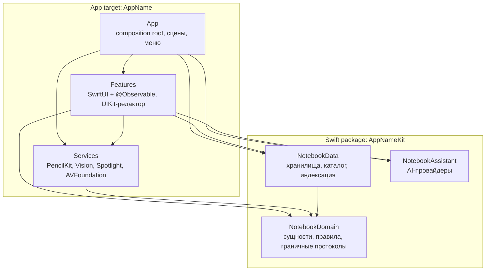
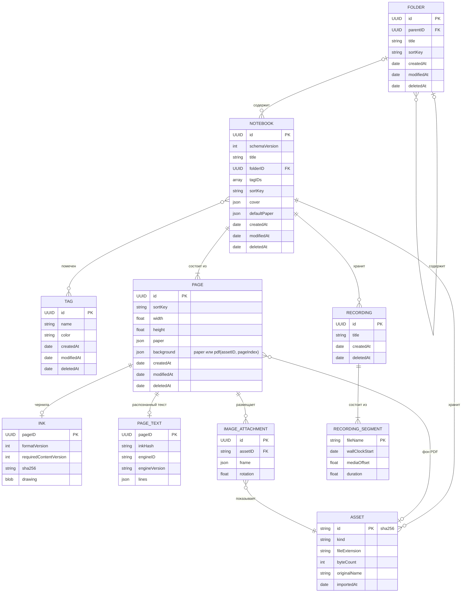

# Product Proposal — Часть 3. Архитектура

> Имя продукта не утверждено. `AppName` — плейсхолдер в имени таргета, схемы, пакета `AppNameKit`, bundle ID и UTType; замена делается одним проходом поиска по репозиторию. Модули, названные по предметной области (`NotebookDomain`, `NotebookData`), от имени продукта не зависят.

## 8. Архитектура и технологический стек

**Контракт тулчейна.** Собираем в Xcode 27.x (Swift 6.4, SDK iPadOS 27), deployment target — iPadOS 26.0. Это вписывается в решение «Xcode 26+»: с апреля 2027 App Store всё равно требует SDK 27, а API iPadOS 27 (распознавание рукописи, стабильные ID штрихов, `MetricManager`) нужны уже сейчас за `if #available(iPadOS 27, *)`. С первого коммита закладываем требования SDK 27: только SwiftUI App lifecycle (сцены обязательны), ключ `UILaunchScreen` в Info.plist, никаких `UIDesignRequiresCompatibility` и `UIRequiresFullScreen`.

### 8.1 Технологический стек

| Область | Выбор | Почему | Отвергнутые альтернативы |
|---|---|---|---|
| Язык | Swift 6 language mode, Swift 6.4 | Гонки данных ловит компилятор, а не пользователь | Swift 5 mode: теряем строгую проверку конкурентности |
| UI | SwiftUI + `@Observable` модели | Liquid Glass, zoom-переходы, сцены и меню — нативно и с минимумом кода | UIKit целиком: атмосферная анимация дороже; TCA: см. 8.9 |
| Поверхность письма | UIKit-контроллер в `UIViewControllerRepresentable`, внутри пул `PKCanvasView` | Один владелец у канвасов, жестов, скролла и undo; SwiftUI не участвует в каждом штрихе | `UIViewRepresentable` на каждую страницу: SwiftUI пересоздаёт канвасы при смене identity |
| Чернила | PencilKit, один `PKDrawing` на страницу, потолок `maximumSupportedContentVersion = .version4` | Системные перо, задержка, barrel roll и squeeze бесплатно; потолок версии гарантирует чтение на iPadOS 26 | Свой движок: годы работы, остаётся запасным путём, если провалится спайк S1. PaperKit: непрозрачный формат и системный стиль разметки |
| Хранение (источник истины) | Файловые пакеты блокнотов: JSON-манифест, файл чернил на страницу, неизменяемые ассеты | Повреждение изолировано страницей, запись затрагивает одну страницу, структура ложится на записи CloudKit | SwiftData/Core Data как основное хранилище: блобы в одном файле БД, одна точка отказа. UIDocument/`DocumentGroup`: см. 8.9 |
| Каталог и поиск в приложении | SQLite из системной `libsqlite3` + FTS5, производный и пересобираемый | Полнотекстовый поиск по десяткам тысяч страниц; миграции не нужны: удалили и пересобрали | SwiftData для каталога: нет полнотекстового индекса. GRDB: сторонняя зависимость |
| PDF (1.0) | PDFKit для импорта и экспорта, `CGPDFPage` в `CATiledLayer` как фон страницы | Один конвейер страниц для пустых и PDF-страниц; исходный PDF не меняется | `PDFView` + `PDFPageOverlayViewProvider`: размытые чернила при зуме, конфликт вложенных scroll view |
| Аудио (1.0) | AVFoundation: `AVAudioEngine` + `AVAudioFile`, сегменты CAF, после остановки — AAC | CAF читается без финализации заголовка, поэтому падение не уничтожает лекцию | `AVAudioRecorder` сразу в `.m4a`: файл, скорее всего, нечитаем после падения |
| Распознавание рукописи | `PKStrokeRecognizer` на iPadOS 27+, Vision `RecognizeTextRequest` по растру страницы на 26 | Единственный системный путь к поиску по рукописи, всё на устройстве | Облачный OCR: бюджет $0 и приватность |
| Расшифровка (1.0) | Speech: `SpeechTranscriber`; для ru-RU — `DictationTranscriber` / `SFSpeechRecognizer` on-device | На устройстве и бесплатно; поддержку русского проверяем в рантайме | Транскрипция через OpenAI как основной путь: AI обязан оставаться опциональным |
| Системный поиск | Core Spotlight: именованный `CSSearchableIndex` с классом защиты, элемент на страницу | Конспект находится из Spotlight; в 1.0 поверх добавляется App Intents `IndexedEntity` | Default index: Apple не рекомендует его для production |
| Синхронизация (1.0) | CloudKit через `CKSyncEngine` поверх файлового хранилища | Явное разрешение конфликтов на уровне страницы, `CKAsset` для чернил, зона на блокнот | SwiftData + CloudKit: непрозрачный last-writer-wins, ограничения схемы, сбои на iOS 26. Пакеты в iCloud Drive: конфликт целиком на документ |
| AI (опционально) | Свой протокол `AssistantProvider`: FoundationModels on-device и OpenAI REST через `URLSession`; изображения — системный лист Image Playground или OpenAI | Приложение полностью работает без AI; русский текст уходит в OpenAI, потому что Apple Intelligence русский не поддерживает | SDK OpenAI: зависимость. `ImageCreator`: deprecated в iPadOS 27. Private Cloud Compute: управляемый entitlement и дневные лимиты |
| Секреты | Keychain, `kSecAttrAccessibleWhenUnlockedThisDeviceOnly` | Ключ не покидает устройство и не попадает в экспорт | `UserDefaults`, файл |
| Монетизация (позже) | StoreKit 2 | Нативно, $0, async API; архитектура от модели монетизации не зависит | RevenueCat и аналоги |
| Диагностика | `Logger`, `OSSignposter`, MetricKit (`MXMetricManager` на 26, `MetricManager` на 27), Xcode Organizer | $0, без сторонних SDK и без отправки данных | Crashlytics, Sentry |
| Unit- и интеграционные тесты | Swift Testing | Параметризация, теги, пакет тестируется `swift test` на macOS-хосте без симулятора | XCTest для unit-тестов |
| UI- и performance-тесты | XCTest: `XCUIApplication`, `measure` + `XCTMetric` | Swift Testing не покрывает UI и метрики | Сторонние UI-фреймворки |
| Стиль кода | `swift-format` из тулчейна, `.swift-format` в корне | Ноль дополнительных инструментов, встроен в Xcode, одна версия на Linux и macOS | SwiftLint (Homebrew или плагин-зависимость), nicklockwood/SwiftFormat (второй форматтер) |
| Описание проекта | Коммитим `AppName.xcodeproj` с folder-synchronized groups, настройки — в `.xcconfig` | Добавление файлов не меняет проектный файл, настройки ревьюятся как текст, «открыл и запустил» без генераторов | XcodeGen, Tuist: лишний инструмент у каждого участника и в CI, сгенерированный проект в `.gitignore` |
| CI | GitHub Actions: стандартный раннер `xcode-27` для сборки и тестов, `ubuntu-24.04` для линта | Для публичного репозитория стандартные раннеры бесплатны и без лимита минут | Bitrise, CircleCI. Xcode Cloud — только для релизов после вступления в Developer Program |

### 8.2 Архитектурный обзор

Прагматичная Clean Architecture: четыре слоя, зависимости направлены внутрь, а протоколы появляются только там, где у границы больше одной реализации.

- **Domain** (`NotebookDomain`) — сущности и value types (`Notebook`, `Page`, `Folder`, `Tag`, `Asset`, `Recording`, `SortKey`, `PageSize`, `InkData`), платформенно-независимые правила (порядок страниц, политика автосохранения, сопоставление штриха с аудио), события `NotebookChange` и протоколы настоящих границ. Импортирует только Foundation.
- **Data** (`NotebookData`) — `LibraryStore` и `NotebookStore`, формат пакета, конверт чернил, снимки, восстановление, каталог и FTS-индекс на SQLite, конвейер индексации. Не знает про UIKit, SwiftUI и PencilKit: чернила для него — непрозрачные байты с версией контента.
- **Features** (app target) — SwiftUI views, `@Observable` модели и UIKit-редактор. Рядом лежит папка `Services` с адаптерами платформенных фреймворков: PencilKit-кодек и рендер миниатюр, Vision и `PKStrokeRecognizer`, Core Spotlight, AVFoundation.
- **App** (app target) — композиционный корень `AppDependencies`, сцены, команды меню, реакция на `scenePhase`.



**Правило зависимостей.** Domain не зависит ни от чего. Data зависит только от Domain. Фичи пользуются публичным API Data и Domain напрямую. Объекты создаёт только App. Обратных стрелок нет, и это проверяет компилятор, потому что Domain и Data — отдельные SwiftPM-таргеты.

Отступление от «книжной» Clean Architecture сделано сознательно: фичи вызывают конкретные `NotebookStore` и `LibraryStore` без протоколов-репозиториев. Реализация у них одна, а тесты гоняют настоящее хранилище во временной папке. Это быстрее и честнее моков, которые проверяют сами себя.

| Граница | Протокол | Причина |
|---|---|---|
| Распознавание рукописи | `HandwritingRecognizer` | Две реальные реализации по версии ОС: `PKStrokeRecognizer` (27+) и Vision (26) |
| AI | `AssistantProvider` | Две реальные реализации (Apple on-device, OpenAI) с разными возможностями |
| Хранилища, каталог, индексатор | Нет | Одна реализация; тесты на реальной файловой системе во временной папке |
| Файловая система, сеть | Нет | Временные папки; для сети — `URLProtocol`-заглушка в тестовой `URLSessionConfiguration` |
| Время | Нет | Политика автосохранения — чистая функция над `ContinuousClock.Instant`, фейковые часы не нужны |
| Миниатюры, запись звука, Spotlight | Нет | Одна реализация; проверяются на симуляторе и устройстве |
| Разрешение конфликтов синхронизации (1.0) | Нет | Merge — чистая функция в `NotebookData`, тестируется без CloudKit; сам движок — конкретный тип |

**Модули.** Один app target и один локальный пакет `Packages/AppNameKit`:

| Модуль | Платформы | Зачем отдельный |
|---|---|---|
| `AppName` (app target) | iPadOS 26 | UI, редактор, платформенные адаптеры; изоляция по умолчанию — `MainActor` |
| `NotebookDomain` | iOS 26, macOS 26 | Компилятор не даёт Domain импортировать хранилище или UI |
| `NotebookData` | iOS 26, macOS 26 | Самая ценная логика (формат, восстановление, индекс) тестируется `swift test` на macOS-хосте за секунды |
| `NotebookAssistant` | iOS 26, macOS 26 | Изолирует сеть, ключ и FoundationModels; появляется вместе с AI-функцией |
| `NotebookSync` (1.0) | iOS 26, macOS 26 | CloudKit, записи и merge; появляется вместе с синхронизацией |

macOS в пакете объявлен только ради быстрых тестов на хосте; приложение выходит только на iPad. Фичи не выносим в модули: UI-код всё равно тестируется на симуляторе, поэтому скорости тестов это не добавит, а `public`-boilerplate и накладные расходы Xcode вырастут. Пересмотрим, когда появится второй разработчик на одной фиче, инкрементальная сборка станет мешать работе или код понадобится расширению (виджет, Share Extension).

### 8.3 Ключевые архитектурные решения

Часть решений упирается в поведение платформы, которое документация не описывает. Эти вопросы закрываем спайками на iPad Air владельца до начала UI-работ:

| Спайк | Вопрос | Критерий успеха | Что блокирует |
|---|---|---|---|
| S1 | Зум и пул канвасов на блокноте из 300 страниц: зум через раскладку или постраничный режим; память undo-снимков; отключение встроенного undo PencilKit | Чёткие чернила при 1–4x, нет мерцания при письме, 0 hitches при смене страниц, задержка на уровне Apple Notes | Редактор |
| S2 | Качество распознавания русского и английского рукописного текста: Vision на 26, `PKStrokeRecognizer` на 27 | Доля найденных слов на эталонном конспекте; цифры фиксируем в `docs/spikes/` | Поиск по рукописи |
| S3 | Сохраняется ли `PKStrokePath.creationDate` при лассо, ластике, копировании на 26 и 27 | Даты сохраняются или правила их изменения известны | Аудиосинхронизация и merge (1.0) |
| S4 | Аварийная устойчивость записи звука: `kill -9` посреди лекции | Все сегменты воспроизводятся, потеря не больше 1 с | Аудио (1.0) |
| S5 | Есть ли FTS5 в системной SQLite (`PRAGMA compile_options`), скорость запроса на 50 тыс. страниц | FTS5 доступен, запрос ≤ 150 мс | Поиск |

#### ADR-01. Источник истины — файловые пакеты, каталог производный

**Контекст.** `PKDrawing` сериализуется только целиком. Приоритет «никогда не терять заметку» стоит выше простоты, а в 1.0 придёт синхронизация.

**Решение.** Каждый блокнот — самодостаточный пакет-директория (раскладка в 8.4). Папки и теги лежат в `library.json`. Каталог `Index/catalog.sqlite` — производный индекс для быстрого списка библиотеки и поиска; он строится из пакетов и пересобирается при любом сомнении. Чернила, PDF и изображения в БД не хранятся.

**Последствия.** Порча одного файла задевает одну страницу, а не библиотеку. Миграции каталога не нужны. Пакет копируется, экспортируется и снапшотится средствами файловой системы. Цена — код консистентности между пакетом и каталогом. Его упрощает то, что каталог только читает пакеты и никогда в них не пишет.

#### ADR-02. Формат пакета и конверт чернил

**Контекст.** Формат `PKDrawing` закрыт и версионируется Apple: iPadOS 26 не откроет рисунок с `PKContentVersion.version5` из iPadOS 27. `Codable` молча выбрасывает незнакомые ключи.

**Решение.**
- Файл страницы — конверт: magic, версия конверта, `requiredContentVersion`, длина payload, SHA-256 (CryptoKit), затем `dataRepresentation()`. Так мы отличаем усечение и тихую порчу от «записано более новой PencilKit».
- `maximumSupportedContentVersion = .version4` на `PKCanvasView` и на `PKToolPicker`, если он используется. Потолок поднимаем только вместе с минимальной версией ОС.
- Файл чернил создаётся при первом штрихе: нет файла — страница пустая.
- Схема v1 с первого дня содержит PDF-фон страницы и записи звука, поэтому PDF и аудио в 1.0 не потребуют миграции.

**Последствия.** Любая страница открывается на любом поддерживаемом устройстве, в том числе после синхронизации. Конверт позволяет позже мигрировать payload (например, в Bézier-представление iPadOS 27 или PaperKit), не угадывая формат.

#### ADR-03. Атомарная запись и автосохранение

**Контекст.** На iPad с батареей реальные угрозы — падение процесса и jetsam, а не потеря питания. Переименование на APFS атомарно, и для этих угроз его достаточно; `F_FULLFSYNC` не нужен. Писать на каждый штрих дорого: страница переписывается целиком.

**Решение.**
- Все записи пакета делает один actor `NotebookStore` на блокнот: он сериализует запись и никогда не трогает main thread. Отложенные сохранения объединяет `EditorSession`, поэтому в store уходит только последний снимок страницы, уже закодированный вне main.
- Запись: временный файл в `.itemReplacementDirectory` того же тома, затем `replaceItemAt` с сохранением предыдущего поколения как `.previous`. Запись поверх файла запрещена.
- Политика: сохранение через 2 с простоя после последнего изменения, но не позже 10 с от первого несохранённого изменения при непрерывном письме.
- Немедленный сброс: страница уходит из живого окна или её канвас переиспользуется, блокнот закрывается, `scenePhase` становится `.inactive` (на `.background` только проверяем завершение), приходит memory warning, останавливается запись звука.
- Каждый сброс оборачивается в `beginBackgroundTask` с самого начала, а не только при уходе в фон: Apple выдаёт assertion асинхронно, и приложение может быть приостановлено раньше.

```swift
public struct AutosavePolicy: Sendable {
    public var idleDelay: Duration = .seconds(2)
    public var maximumDelay: Duration = .seconds(10)

    public init() {}

    public func deadline(
        firstUnsavedChange: ContinuousClock.Instant,
        latestChange: ContinuousClock.Instant
    ) -> ContinuousClock.Instant {
        min(latestChange + idleDelay, firstUnsavedChange + maximumDelay)
    }
}
```

```swift
public actor NotebookStore {
    public nonisolated let notebookID: Notebook.ID
    public nonisolated let changes: AsyncStream<NotebookChange>

    private let package: NotebookPackage
    private let changesContinuation: AsyncStream<NotebookChange>.Continuation

    public init(package: NotebookPackage) {
        let (changes, continuation) = AsyncStream.makeStream(of: NotebookChange.self)
        self.notebookID = package.notebookID
        self.package = package
        self.changes = changes
        self.changesContinuation = continuation
    }

    public func saveInk(_ ink: InkData, for pageID: Page.ID) throws {
        try FileManager.default.replaceContents(
            of: package.inkURL(for: pageID),
            with: InkEnvelope(ink).encoded(),
            keepingPreviousAs: package.previousInkFileName(for: pageID)
        )
        changesContinuation.yield(.inkSaved(pageID))
    }
}

extension FileManager {
    /// A crash at any point leaves either the old or the new file, never a partial one,
    /// and the previous generation stays on disk as the first recovery fallback.
    func replaceContents(of url: URL, with data: Data, keepingPreviousAs backupName: String) throws {
        guard fileExists(atPath: url.path(percentEncoded: false)) else {
            try data.write(to: url, options: .atomic)
            return
        }
        let stagingDirectory = try self.url(
            for: .itemReplacementDirectory,
            in: .userDomainMask,
            appropriateFor: url,
            create: true
        )
        defer { try? removeItem(at: stagingDirectory) }

        let stagedFile = stagingDirectory.appending(path: url.lastPathComponent)
        try data.write(to: stagedFile)
        _ = try replaceItemAt(
            url,
            withItemAt: stagedFile,
            backupItemName: backupName,
            options: .withoutDeletingBackupItem
        )
    }
}
```

У потока `changes` один потребитель — маршрутизатор в композиционном корне. Он раздаёт события каталогу, индексатору и, в 1.0, синхронизации.

**Последствия. Максимальное окно потерь** — 10 секунд непрерывного письма при падении процесса или jetsam в foreground. На практике это обычно меньше 2 секунд: паузы в письме сами запускают сохранение. При уходе в фон, закрытии блокнота и смене страницы потерь нет. Журнал на каждый штрих рассматривали и отвергли: на iPadOS 26 у штрихов нет стабильных ID, поэтому журнал превращается в отдельный формат со своим восстановлением. Вернёмся к нему, если реальные данные покажут потери.

#### ADR-04. Снимки и откат

**Контекст.** Атомарная запись защищает от падений, но не от ошибок пользователя («стёр полстраницы вчера») и не от ошибок в нашем коде.

**Решение.** При первом изменении за сеанс редактирования пакет клонируется через `FileManager.copyItem` в `Snapshots/<notebookID>/<ISO 8601>.notebook`. На APFS это клон, и место он занимает только под изменённые потом страницы. Храним последние 5 сеансов и по одному снимку в день за 7 дней, лишние удаляем в фоне. `Snapshots/` и `Index/` помечены `isExcludedFromBackup`: каталог производный, а клоны в бэкапе устройства превратились бы в полные копии.

**Последствия.** У каждой страницы три уровня отката: текущий файл, `.previous`, последний снимок. Данные для будущей функции «Восстановить прошлую версию» копятся с MVP. Снимки никогда не синхронизируются.

#### ADR-05. Канвас под SwiftUI с минимальной задержкой

**Контекст.** Стоимость `PKCanvasView` растёт с общим числом штрихов. Зум канваса через transform родительского scroll view даёт размытие (многолетние отчёты разработчиков) и мерцание при письме (Apple DTS подтвердила его в 2026 году и обходного пути не нашла).

**Решение.**
- SwiftUI владеет только хромом: панелями, палитрой и индикатором страниц. Поверхность письма — `NotebookCanvasViewController` в `UIViewControllerRepresentable`. Делегат `PKCanvasViewDelegate`, жесты, скролл и пул канвасов живут в контроллере.
- `PKDrawing` никогда не проходит через `@State`, `@Binding` или наблюдаемые свойства. `updateUIViewController` дешёвый и идемпотентный: передаёт только выбранный инструмент и режим, и только если они изменились.
- Виртуализация: не больше 3 живых `PKCanvasView` (видимые страницы плюс соседняя). Остальные страницы показывают растровое превью поверх фона. Чернила следующей страницы декодируются заранее вне main. Превью остаётся на экране до `canvasViewDidFinishRendering`, чтобы при подмене не мигало.
- Режим обзора, где видно больше 3 страниц, обходится без живых канвасов: это навигация, а не письмо.
- `drawingPolicy = .default`, чтобы уважать системную настройку «Только Apple Pencil». У внешнего scroll view `allowedTouchTypes` ограничены пальцем, поэтому Pencil никогда не скроллит. SwiftUI-жесты на предках канваса запрещены, декоративные слои помечены `.allowsHitTesting(false)`.
- Механику зума выбирает спайк S1. Базовая ставка — зум через раскладку: страницы раскладываются в размере `pageSize × zoom`, канвас фиксирует `zoomScale`, а transform живёт только во время щипка. Запасной вариант — постраничный режим, где зумом и скроллом страницы владеет активный канвас.

**Последствия.** Нагрузка на канвас не зависит от длины блокнота. Squeeze Pencil Pro (`UIPencilInteraction`) и hover (`UIHoverGestureRecognizer`) обрабатываются в контроллере и передаются в модель хрома как события. Если S1 не найдёт приемлемого варианта, это главный риск проекта: тогда остаются только постраничный режим или собственный движок чернил.

#### ADR-06. Undo/redo

**Контекст.** Встроенный undo PencilKit привязывает действия к конкретному `PKCanvasView`. При переиспользовании канваса из пула история страницы либо теряется, либо применяется к чужой странице. Кроме того, перемещение изображений и операции со страницами тоже должны отменяться.

**Решение.** Один `UndoManager` на сеанс редактирования блокнота. Целью регистрации служит модель страницы, а не view: на каждое `canvasViewDrawingDidChange` регистрируем восстановление предыдущего значения `PKDrawing`. Встроенные регистрации канваса подавляем; способ (подкласс канваса с переопределённым `undoManager`) и совместимость с системными жестами отмены проверяет S1. При восстановлении на живой странице флаг подавляет повторную регистрацию изменения. Глубина ограничена 100 шагами, история очищается при закрытии блокнота.

**Последствия.** ⌘Z и жест отмены работают на любой странице независимо от пула. Память на снимки и совместимость подавления с лассо проверяет S1. Если снимки окажутся дорогими, для частого случая «штрихи добавлены в конец» храним дельту.

#### ADR-07. Изображения

**Решение.** При импорте из Photos, Files, перетаскивания или вставки изображение уменьшается через `CGImageSourceCreateThumbnailAtIndex` (длинная сторона ≤ 4096 px) и сохраняется как HEIC в `assets/<sha256>.heic`. Страница хранит размещение: `assetID`, рамку в точках страницы и поворот. Изображения рисуются в UIKit-слое под чернилами. Ассеты неизменяемы и адресуются по содержимому; неиспользуемые удаляются при очистке корзины, причём учитываются и удалённые страницы.

**Последствия.** Дубликаты бесплатны, синхронизация ассета в 1.0 сводится к загрузке одного неизменяемого `CKAsset`, а память на странице предсказуема.

#### ADR-08. Страницы на основе PDF (1.0)

**Решение.** Импортированный PDF один раз копируется в `assets/<sha256>.pdf` и больше не меняется. Каждая страница блокнота ссылается на `(assetID, pageIndex)`; чернила хранятся отдельно, как у обычной страницы. Фон рисует наша страница: `CGPDFPage` в `CATiledLayer` с общим для всех страниц зумом. Текстовый слой (`PDFPage.string`) извлекается при импорте в кэш текста страницы. Миниатюры берутся из `PDFPage.thumbnail(of:for:)`, доступ к каждому `PDFDocument` сериализован. Экспорт создаёт новый PDF с прожжёнными чернилами, исходный файл пользователя не трогается.

**Последствия.** PDF-страница отличается от пустой только фоном, поэтому зум, пул канвасов, undo и сохранение общие. `PDFView` с оверлеями не используем из-за размытых чернил при зуме и конфликта вложенных scroll view. Производительность тайлинга на больших PDF проверяем вместе с S1.

#### ADR-09. Тайминг штрихов для аудио (данные с MVP)

**Контекст.** `PKStrokePath.creationDate` и `PKStrokePoint.timeOffset` есть с iOS 14 и уже сохраняются внутри `PKDrawing`. Стабильные ID штрихов есть только в iPadOS 27.

**Решение.** Отдельной таблицы таймингов не заводим. В MVP действует правило: любое программное преобразование штриха (масштаб страницы, вставка, перенос) создаёт `PKStrokePath` с исходной `creationDate`. В 1.0 запись состоит из сегментов `{fileName, wallClockStart, mediaOffset, duration}`; пауза, возобновление и прерывание открывают новый сегмент. `wallClockStart` фиксируется на первом буфере, а не на нажатии кнопки. Чтобы найти момент штриха, ищем сегмент, содержащий `creationDate`, и перематываем на `mediaOffset + (creationDate − wallClockStart)` с запасом около 2 с. Для воспроизведения штрихи страницы один раз сортируются по дате, а положение воспроизведения находим бинарным поиском.

**Последствия.** Конспекты, написанные в MVP, в 1.0 сразу готовы к функции «тап по штриху — услышать момент», если писались под запись. Сохранение дат при ластике и лассо на iPadOS 26 проверяет S3.

#### ADR-10. Поиск и индексация

**Решение.**
- Источники текста страницы: распознанная рукопись, текстовый слой PDF, название блокнота и теги.
- Кэш распознавания — файл `text/<pageID>.json` в пакете: `inkHash`, движок, версия движка, строки с рамками. Пишет его, как и всё в пакете, `NotebookStore` по запросу индексатора. Кэш переживает пересборку каталога, уезжает с экспортом и не требует повторного распознавания. Он устаревает, когда меняется `inkHash`, движок или его версия: `PKStrokeRecognizer.recognitionVersion` меняется с обновлением ОС.
- `SearchIndexer` (actor, приоритет `.utility`) берёт устаревшие страницы через 10 с простоя, при уходе со страницы и при закрытии блокнота. Пока Pencil касается экрана, индексатор ставится на паузу; при `thermalState` `.serious`/`.critical` и в Low Power Mode работа откладывается. Очередь вычисляется из устаревших записей, поэтому хранить её отдельно не нужно и после падения ничего не теряется. Большой бэклог после обновления ОС обрабатывает `BGProcessingTask` на зарядке.
- Поиск в приложении идёт по FTS-таблице каталога с нормализацией регистра, диакритики и `ё → е` и с префиксным совпадением. На 27 подсветку найденного даёт `PKStrokeRecognizer.search`, на 26 — рамки строк из Vision.
- Core Spotlight: `CSSearchableIndex(name:protectionClass:)`, элемент на страницу (`uniqueIdentifier` = pageID, `domainIdentifier` = notebookID), пакетная запись с client state. Поиск в приложении от Spotlight не зависит: индексирование там асинхронное и может быть недоступно.

```swift
public protocol HandwritingRecognizer: Sendable {
    var engine: RecognitionEngine { get }

    func recognizeText(in ink: InkData, pageSize: PageSize) async throws -> RecognizedText
}

public struct RecognitionEngine: Hashable, Codable, Sendable {
    public let id: String
    public let version: String
}
```

**Последствия.** На iPadOS 26 рукописный поиск держится на Vision OCR по растру и будет слабее, особенно на кириллице (S2). Если минимальную версию когда-нибудь поднимем до 27, реализация на Vision удаляется без изменений в остальных слоях.

#### ADR-11. Готовность к синхронизации и CKSyncEngine в 1.0

**Решение для MVP.** Модель с первого дня соблюдает правила, которые позволят подключить синхронизацию без хирургии над схемой:
1. UUID, сгенерированный на клиенте, у каждой сущности и файла.
2. Порядок задаётся дробными строковыми `SortKey`, а не массивами ID. Совпадения разрешаются по ID.
3. Мягкое удаление через `deletedAt` и окончательное удаление через 30 дней.
4. `createdAt`/`modifiedAt` у каждой сущности. Это данные для отображения; конфликты в 1.0 определяют change tags CloudKit.
5. Никаких ограничений уникальности; у системных сущностей фиксированные UUID.
6. Неизменяемые ассеты, адресуемые по содержимому.
7. Метаданные страницы и её чернила хранятся раздельно.
8. Координаты в точках страницы фиксированного размера, независимые от устройства.
9. Каждое изменение проходит через API хранилища и порождает `NotebookChange`.
10. `schemaVersion` и `requiredContentVersion` сохраняются всегда.

**Решение для 1.0.** `CKSyncEngine` поверх файлового хранилища. Каждый блокнот получает свою зону (это открывает путь к `CKShare` и делает удаление блокнота удалением зоны), папки и теги живут в зоне Library. Типы записей: `Notebook`, `Page` (поля + чернила как `CKAsset`), `Asset`, `Recording`, `Folder`, `Tag`. Сериализация состояния движка и system fields записей хранятся в `Sync/` на устройстве, а не в пакетах. Конфликты разрешаются по странице:
- метаданные — last-writer-wins по полям;
- чернила — трёхсторонний merge множеств штрихов относительно последней синхронизированной версии;
- если merge небезопасен, рядом с оригиналом появляется страница «конфликтная копия».

Ключ штриха — `PKStroke.id` на 27; на 26 — отпечаток из `creationDate`, числа точек, первой и последней точки и типа чернил. При запуске сверяем локальные изменения с последним синхронизированным состоянием, поэтому изменение, сделанное перед падением, не потеряется для отправки.

**Последствия.** Чернила не теряются ни при каком конфликте. Это заметный объём собственного кода: merge, квоты (`CKError.quotaExceeded`), смена аккаунта. В плане 1.0 его надо бюджетировать отдельно. Без платного Developer Program CloudKit нельзя проверить на устройстве, поэтому синхронизацию разрабатываем после вступления в программу.

#### ADR-12. AI-провайдеры

**Контекст.** AI опционален. Apple Intelligence не поддерживает русский, у on-device модели контекст 4096 токенов, `ImageCreator` в iPadOS 27 deprecated. Прецедент App Review: приложение с ключом пользователя отклонили по 3.1.1 как «ключ, открывающий функциональность».

**Решение.** Свой небольшой протокол в `NotebookAssistant` и две реализации: `FoundationModelsProvider` и `OpenAIProvider` (REST через `URLSession`, без SDK). `AssistantRouter` в приложении определяет язык текста (`NLLanguageRecognizer`) и спрашивает у провайдеров доступность. По умолчанию выбирается Apple on-device (приватно и бесплатно), OpenAI — если он подключён и Apple не подходит, или если пользователь выбрал его явно. Если подходящего нет, пункт меню остаётся на месте, но приглушён и объясняет почему. Ключ OpenAI хранится в Keychain и передаётся провайдеру при создании, так что сам провайдер о Keychain не знает. Перед первым запросом с содержимым заметок показываем явное согласие, где названа OpenAI и перечислено, что отправляется (Guideline 5.1.2(i)). Промпты версионируются и рассчитаны на 4K: chunk-and-summarize и `@Generable` для структурированных ответов. Генерация изображений в протокол не входит: у Apple это системный лист `imagePlaygroundSheet`, а не API. Роутер возвращает маршрут — показать лист, если `supportsImagePlayground`, или вызвать OpenAI Images.

```swift
public protocol AssistantProvider: Sendable {
    var id: AssistantProviderID { get }

    func availability(for language: Locale.Language) async -> AssistantAvailability

    /// Each element is the complete response so far, so the UI can render any element without merging deltas.
    func streamResponse(to prompt: AssistantPrompt) -> AsyncThrowingStream<String, any Error>
}

public enum AssistantAvailability: Equatable, Sendable {
    case available(contextTokenLimit: Int)
    case unavailable(AssistantUnavailability)
}

public enum AssistantUnavailability: Equatable, Sendable {
    case deviceNotEligible
    case turnedOffInSettings
    case modelNotReady
    case languageNotSupported
    case apiKeyMissing
}
```

**Последствия.** Ни одна функция приложения не требует ключа, и ничего платного ключ не открывает. На iPadOS 27 `OpenAIProvider` можно перевести на протокол `FoundationModels.LanguageModel`, чтобы обе реализации делили `LanguageModelSession`; сейчас этого не делаем.

#### ADR-13. Ошибки и восстановление, видимые пользователю

**Решение.**
- В `NotebookData` ошибки — доменные enum (`NotebookStoreError.inkCorrupted(Page.ID)`, `.requiresNewerSystem`, `.schemaNewerThanApp`, `.outOfSpace`). Перевод в понятные сообщения из String Catalog делает только app target (`UserFacingIssue`), поэтому у пакета нет пользовательских строк.
- Сбой ограничен наименьшей единицей: страница с проблемой показывает спокойную заглушку, остальной блокнот работает. Модальные алерты только для действий, которые пользователь сам начал (например, импорт).
- Писать нельзя запретить из-за побочного сбоя. Миниатюры, индексация и снимки при ошибке молча откладываются и повторяются.
- `try!`, `fatalError` и force unwrap в путях данных запрещены (это проверяет `swift-format`). Нарушенные инварианты дают `assertionFailure` в Debug и запись в `Logger` в Release.

**Последствия.** Конкретные сценарии сбоев и реакции на них — в таблице 8.6.

#### ADR-14. Модель конкурентности

**Решение.**
- App target: изоляция по умолчанию `MainActor` и Approachable Concurrency. Views, модели, контроллер редактора, `PKCanvasView` и `EditorSession` живут на главном акторе.
- Пакет: изоляция по умолчанию `nonisolated`, включены `NonisolatedNonsendingByDefault`, `InferIsolatedConformances`, `ExistentialAny`, `MemberImportVisibility`.
- Акторы: `LibraryStore` (библиотека; выдаёт ровно один `NotebookStore` на блокнот на весь процесс), `NotebookStore`, `Catalog` (одно SQLite-соединение в WAL), `SearchIndexer`, `ThumbnailRenderer`.
- Тяжёлые вычисления (кодирование `PKDrawing`, Vision) — `@concurrent` функции. `PKDrawing` — `Sendable`, поэтому значение захватывается на main и уходит в фон без копирования на нашей стороне.
- `EditorSessionRegistry` (MainActor) держит один сеанс на блокнот для всех окон. Второе окно того же блокнота делит сеанс, поэтому окна не перезаписывают файлы друг друга.
- Колбэк tap у `AVAudioEngine` работает на аудиопотоке, вне Swift concurrency. Он только пишет в `AVAudioFile` и не обращается к акторам синхронно.
- `@unchecked Sendable` и `nonisolated(unsafe)` допускаются только с комментарием «почему»; `DispatchQueue` — только там, где этого требует API.

**Последствия.** Гонки за файлы невозможны по построению. Задачи индексации и пререндера отменяются, как только начинается письмо. Предупреждения о конкурентности в CI считаются ошибками.

#### ADR-15. Внедрение зависимостей

**Решение.** Композиционный корень `AppDependencies` (`@Observable final class`, изолирован на `MainActor` настройкой таргета) создаётся один раз в `AppNameApp` из `AppDirectories` и передаётся в сцены через `.environment(_:)`. Сцена создаёт модели фич и передаёт им зависимости явно через `init`, так что зависимости видны в сигнатуре. Для тестов, превью и UI-тестов есть `AppDirectories.temporary()` и аргумент запуска, который подставляет чистую библиотеку с фикстурами. Сервис-локаторы и DI-контейнеры не используем.

**Последствия.** Граф объектов (около десяти сервисов) читается в одном файле. Ошибка в зависимостях проявляется при компиляции, а не в рантайме.

### 8.4 Модель данных



Где что живёт: `FOLDER` и `TAG` — в `library.json`. `NOTEBOOK`, `PAGE`, `IMAGE_ATTACHMENT`, метаданные `ASSET`, `RECORDING` и `RECORDING_SEGMENT` — в `notebook.json`. Единый манифест делает структурные изменения (добавить страницу, привязать запись) одной атомарной записью; на 300 страниц это около 60 КБ. `INK` — файлы `ink/`, `PAGE_TEXT` — файлы `text/`. Каталог SQLite хранит только производные сводки блокнотов и FTS-таблицу.

Раскладка библиотеки:

```text
Library/Application Support/
├── library.json                  # папки и теги
├── library.json.previous
├── Notebooks/
│   └── <notebookID>.notebook/    # пакет блокнота, UTType dev.devlet.AppName.notebook
├── Snapshots/                    # APFS-клоны пакетов; исключены из бэкапа
│   └── <notebookID>/<ISO 8601>.notebook/
├── Recovered/                    # карантин повреждённых файлов; автоматически не удаляется
├── Index/
│   └── catalog.sqlite            # производный каталог и FTS; исключён из бэкапа
└── Sync/                         # 1.0: состояние CKSyncEngine и базы для merge, только на устройстве
Library/Caches/
└── Thumbnails/                   # HEIC; ключ pageID + inkHash + размер + appearance
```

Пакет одного блокнота:

```text
<notebookID>.notebook/
├── notebook.json                 # блокнот, страницы, вложения, ассеты, записи
├── notebook.json.previous
├── ink/
│   ├── <pageID>.ink              # конверт + PKDrawing; появляется с первым штрихом
│   └── <pageID>.ink.previous
├── text/
│   └── <pageID>.json             # кэш распознанного текста
├── assets/
│   ├── <sha256>.pdf              # неизменяемые, адресуются по содержимому
│   └── <sha256>.heic
└── audio/                        # 1.0
    └── <recordingID>/
        ├── segment-000.caf       # сегменты по ~5 минут во время записи
        └── recording.m4a         # AAC после остановки
```

Конверт файла чернил (little-endian):

| Поле | Размер | Назначение |
|---|---|---|
| magic | 4 байта | Отличить наш файл от чужого или обнулённого |
| `formatVersion` | `UInt16` | Версия конверта |
| `requiredContentVersion` | `UInt16` | `PKContentVersion`, нужная для чтения |
| `payloadLength` | `UInt64` | Ловит усечение |
| `sha256` | 32 байта | Ловит тихую порчу |
| payload | N | `PKDrawing.dataRepresentation()` |

**Версии формата и миграции.**
- В корне каждого JSON лежит `schemaVersion`. Более старая схема при открытии мигрирует вперёд в памяти: цепочка шагов v1→v2→… над JSON-объектом до декодирования. На диск результат записывается только при первом реальном изменении, а к этому моменту снимок старой версии уже сделан (ADR-04).
- Схема новее приложения открывается только для чтения и никогда не перекодируется: иначе `Codable` выбросил бы незнакомые поля.
- Типы, которые попадают на диск, объявляют `CodingKeys` явно. В тестах лежат golden-пакеты каждой версии схемы, поэтому переименовать ключ без миграции не получится: тест упадёт.
- Конверт версионируется своим `formatVersion`, payload — через `requiredContentVersion`. Если версия контента выше той, что поддерживает ОС, страница показывается как «создана в более новой iPadOS», а файл остаётся нетронутым.
- Каталог хранит версию в `PRAGMA user_version`; при несовпадении он удаляется и пересобирается.
- Схема CloudKit в 1.0 только расширяется: поля добавляются, но никогда не переиспользуются.

### 8.5 Производительность и бюджеты

Эталонное устройство — iPad Air владельца (M2 или новее, 60 Гц) с Pencil Pro. Бюджеты проверяются на нём. Цифры CI-симулятора на виртуальном M1 шумят, поэтому служат только сигналом регрессии. Нагрузочный блокнот (300 плотных страниц и PDF на 500 страниц) создаётся Debug-командой прямо на устройстве.

| Сценарий | Бюджет | Как измеряем |
|---|---|---|
| Холодный запуск до первого кадра библиотеки | ≤ 400 мс | `XCTApplicationLaunchMetric` на устройстве, launch-метрики MetricKit |
| Открытие блокнота на 300 страниц: первая страница на экране | ≤ 300 мс (из кэшированного превью) | Интервал `OSSignposter` `notebook.open` от тапа до показа |
| Открытие: живой канвас готов к письму | ≤ 500 мс | Signpost до `canvasViewDidFinishRendering` |
| Зависимость открытия от числа страниц | Отсутствует: читаем манифест и 1–3 страницы; разбор манифеста на 300 страниц ≤ 20 мс | Тест в пакете с `ContinuousClock`; signpost |
| Письмо на 60 Гц | 0 hitches во время штриха; на main во время касания нет работы дольше 4 мс; задержка не хуже Apple Notes на том же iPad | Instruments (Animation Hitches, Time Profiler); съёмка 240 fps рядом с Apple Notes |
| Скролл и смена страниц | Hitch ratio < 5 мс/с, без вспышек пустой страницы | `XCTOSSignpostMetric.scrollingAndDecelerationMetric`, Instruments |
| Память | ≤ 350 МБ footprint на блокноте из 300 страниц, ≤ 500 МБ на PDF из 500 страниц, кэш миниатюр ≤ 96 МБ, нет роста после прокрутки туда и обратно | `XCTMemoryMetric`, Allocations/Leaks, memory-метрики MetricKit |
| Миниатюра страницы | ≤ 25 мс вне main; никогда во время скролла | Signpost `thumbnail.render` |
| Сохранение страницы | На main ≤ 1 мс (захват значения); кодирование и запись 500 КБ ≤ 30 мс вне main | Signpost `page.save` |
| Поиск | Первые результаты ≤ 150 мс на 50 тыс. страниц | Performance-тест каталога в пакете |
| Объём записи на диск | ≤ 250 МБ на час непрерывного письма; калибруем после S1 | Disk-write диагностика MetricKit, signpost с размером файла |

Инструменты: интервалы `OSSignposter` вокруг открытия блокнота, подмены страницы, сохранения, рендера миниатюры и распознавания; Instruments (Time Profiler, Allocations, Hangs, Animation Hitches, SwiftUI); MetricKit пишет отчёты в локальный журнал, а пользователь может отправить его сам через share sheet. Своих серверов нет.

### 8.6 Надёжность данных

| Сбой | Обнаружение | Восстановление | Что видит пользователь |
|---|---|---|---|
| Падение посреди записи файла | Временный каталог остался в `.itemReplacementDirectory` | Оригинал цел, потому что замена — один rename; временные каталоги чистятся при запуске | Ничего |
| Падение или jetsam во время письма | Нет несохранённого состояния после запуска | Последняя сохранённая версия страницы | Потеря не больше окна автосохранения (≤ 10 с, обычно ≤ 2 с) |
| Приложение убито в фоне | — | Сброс начат на `.inactive` под background task и завершён до `.background` | Ничего |
| Диск заполнен | `CocoaError.fileWriteOutOfSpace`; перед импортом и записью звука проверяем `volumeAvailableCapacityForImportantUsage` | Правки остаются в памяти и повторяются по таймеру; снимки, миниатюры и индексация отключаются; запись звука останавливается с сохранением сегментов | Постоянный спокойный баннер «Мало места, изменения пока не записаны» со ссылкой на настройки хранилища |
| Повреждён файл страницы | Конверт: magic, длина, SHA-256 | Цепочка `.ink` → `.ink.previous` → последний снимок; если не помогло, файл уходит в `Recovered/`, не удаляется | Страница с пометкой «восстановлена из более ранней версии» или заглушка; остальные страницы работают |
| Страница из более новой iPadOS | `requiredContentVersion` выше поддерживаемой | Файл не трогаем | «Страница создана в более новой iPadOS» |
| Повреждён `notebook.json` | Ошибка декодирования | `.previous` → снимок; в крайнем случае манифест собирается из файлов `ink/` по датам создания | Блокнот открывается с пометкой о восстановлении |
| Схема новее приложения | `schemaVersion` выше поддерживаемой | Режим только для чтения, без перезаписи | «Обновите приложение, чтобы редактировать» |
| Повреждён или удалён каталог | Ошибка SQLite, `user_version` | Удаляем и пересобираем из пакетов в фоне | Индикатор «поиск обновляется» |
| Падение во время записи звука (1.0) | При запуске найдены незавершённые сегменты CAF | Сегменты присоединяются к записи, затем транскодирование | «Запись восстановлена» |
| Конфликт синхронизации (1.0) | `serverRecordChanged` | Метаданные — LWW по полям; чернила — трёхсторонний merge, иначе «конфликтная копия» страницы | Копия страницы рядом с оригиналом, если merge небезопасен |
| Квота iCloud (1.0) | `CKError.quotaExceeded` | Синхронизация на паузе, локально всё сохраняется | Баннер о квоте |
| Ошибочное удаление | — | `deletedAt` и окончательное удаление через 30 дней | Восстановление из «Недавно удалённых» |

**Страховочная сеть.** Экспорт блокнота в PDF (чернила прожжены) и в архив пакета без потерь, который импортируется обратно. Полная резервная копия библиотеки — один архив через `NSFileCoordinator` с `.forUploading`, сохраняется в Files без сторонних библиотек. Бэкап устройства включает `Application Support`, кроме `Snapshots/` и `Index/`.

### 8.7 Безопасность и приватность

- **Защита файлов:** класс по умолчанию `completeUntilFirstUserAuthentication`. Класс `.complete` не подходит: сохранение, индексация и запись лекции должны продолжаться при заблокированном экране. Spotlight-индекс создаётся с тем же классом защиты.
- **Keychain:** ключ OpenAI — generic password с `kSecAttrAccessibleWhenUnlockedThisDeviceOnly`, без синхронизации через iCloud Keychain. Ключ не логируется, не попадает в экспорт и удаляется кнопкой «Отключить OpenAI».
- **Сеть:** единственный внешний хост — `api.openai.com`, и только после согласия пользователя. ATS по умолчанию. Открытый код делает это проверяемым.
- **Без аналитики:** никаких аналитических и крэш-SDK. MetricKit и `Logger` остаются на устройстве. Содержимое заметок и названия логируются с `privacy: .private`.
- **App Privacy:** on-device модели и Image Playground не являются «сбором данных». Для OpenAI консервативно раскрываем «Other User Content» (и Photos, если отправляются изображения) с назначением App Functionality, без трекинга. Окончательные ответы сверяем с актуальными правилами перед отправкой на ревью.
- **Privacy manifest** `PrivacyInfo.xcprivacy`: `NSPrivacyTracking = false`, пустые tracking domains и required-reason коды только для реально вызываемых API. Ожидаемые: `CA92.1` (UserDefaults), `C617.1` (даты файлов в контейнере — сверка каталога с пакетами), `3B52.1` (файлы, выбранные пользователем при импорте PDF), `E174.1` (свободное место перед импортом и записью). Перед каждым релизом проводим аудит.
- **Прочее:** `ITSAppUsesNonExemptEncryption = NO` (только системное шифрование). `NSMicrophoneUsageDescription` в `InfoPlist.xcstrings` появляется в 1.0. В репозитории включены secret scanning с push protection и приватные сообщения об уязвимостях.

### 8.8 Стратегия тестирования

| Уровень | Инструмент | Где запускается | Что покрываем |
|---|---|---|---|
| Domain и Data | Swift Testing | `swift test` на macOS-хосте при каждом push | Round-trip манифеста и конверта; golden-пакеты каждой схемы; порча (усечение, бит-флип, пустой файл, чужой magic, новая версия); цепочка восстановления; режим только для чтения; политика автосохранения; `SortKey`; пересборка каталога; нормализация поиска (регистр, диакритика, `ё → е`); математика сегментов аудио; merge штрихов (1.0) |
| Платформенные адаптеры | Swift Testing в `AppNameTests` | Симулятор iPad | `PKDrawing` ↔ `InkData`, потолок версии контента, миниатюры в светлой и тёмной теме, Vision на латинице, сброс сеанса на `.inactive` |
| Ключевые сценарии | XCTest UI | Симулятор, по расписанию и вручную | Создать блокнот → писать пальцем (Debug-флаг `.anyInput`) → перезапустить и проверить; переименование, папки, теги; поиск; импорт PDF (1.0); удаление и восстановление; `terminate()` внутри окна автосохранения; VoiceOver через `XCUIVoiceOverService` |
| Производительность | XCTest `measure` | Устройство (бюджеты), симулятор (регрессии) | Запуск, открытие 300 страниц, скролл, память |

```swift
@Suite(.tags(.storage))
struct InkRecoveryTests {
    @Test(arguments: InkCorruption.allCases)
    func loadsPreviousGenerationWhenCurrentFileIsDamaged(_ corruption: InkCorruption) async throws {
        let fixture = try NotebookFixture()
        try await fixture.store.saveInk(.sample(seed: 1), for: fixture.pageID)
        try await fixture.store.saveInk(.sample(seed: 2), for: fixture.pageID)
        try corruption.apply(to: fixture.inkURL)

        let recovered = try await fixture.store.ink(for: fixture.pageID)

        #expect(recovered == .sample(seed: 1))
    }
}
```

Тест-планы (JSON, в репозитории): `Unit` (покрытие включено), `UI`, `Sanitizers` (Thread Sanitizer, по расписанию) и конфигурация с псевдолокализацией двойной длины. Последняя проверяет вёрстку на строках из String Catalog, хотя UI пока только на английском.

**Что CI проверить не может:** задержку и ощущение пера; давление, наклон и barrel roll; squeeze, double tap, hover и тактильный отклик Pencil Pro; распознавание кириллицы (симулятор поддерживает только латиницу); локали `SpeechTranscriber` (в симуляторе список пуст); прерывание записи звонком; поведение под нагревом и давлением памяти; CloudKit.

**Ручной чек-лист на iPad Air + Pencil Pro** (перед каждым релизом и после изменений в редакторе):
1. Задержка письма — съёмка 240 fps рядом с Apple Notes, разницы не видно.
2. Все типы чернил: давление, наклон, barrel roll; Reed pen.
3. Squeeze открывает палитру у кончика пера; double tap следует системной настройке.
4. Hover-превью инструмента.
5. Ладонь на экране не оставляет следов; палец скроллит, Pencil пишет; оба значения настройки «Только Apple Pencil».
6. Нагрузочный блокнот на 300 страниц: быстрое листание без вспышек и рывков (Instruments подключён).
7. Зум 1x / 2x / 4x: чернила чёткие, при письме нет мерцания.
8. Закрыть приложение из переключателя посреди письма: после запуска потеря не больше окна. Уйти в фон и закрыть: потерь нет.
9. Заполнить диск тестовым файлом: появился баннер, после освобождения места ничего не потеряно.
10. Узкое окно, Stage Manager, два окна одного блокнота.
11. Тёмная тема, Reduce Motion, Reduce Transparency, Increase Contrast, крайние положения слайдера Liquid Glass (iPadOS 27).
12. Поиск по русскому и английскому рукописному тексту на версии ОС устройства.
13. 1.0: запись лекции при заблокированном экране, звонок посреди записи, тактильный отклик во время записи.
14. Час непрерывного письма: нет замедления и перегрева.

### 8.9 Что мы сознательно НЕ делаем

| Не делаем | Почему | Когда пересмотрим |
|---|---|---|
| VIPER, RIBs, Clean Swift | Пять файлов на экран без выигрыша; SwiftUI и `@Observable` уже разделяют view и состояние | Не планируем |
| TCA | Сторонняя зависимость со своей парадигмой и порогом входа, при этом конфликтует с политикой «$0, Apple only» | Не планируем |
| Координаторы | Навигацию по значениям и окна покрывают `NavigationStack`, `NavigationSplitView` и `openWindow`; координатор в SwiftUI означает борьбу с фреймворком | Не планируем |
| DI-контейнеры | Граф из десятка объектов читается в одном файле; контейнер прячет его и переносит ошибки в рантайм | Не планируем |
| Протокол на каждый сервис и репозиторий | При одной реализации это церемония, а тесты на реальной файловой системе честнее | Когда появится вторая реальная реализация |
| UseCase-класс на каждое действие | Логика живёт в хранилищах и моделях; отдельный тип появляется только для операций над несколькими хранилищами (импорт PDF, экспорт) | По мере появления таких операций |
| Модуль на каждую фичу | Тесты UI от этого не ускоряются, а `public`-boilerplate растёт | Второй разработчик, медленная сборка, расширения |
| Сторонние runtime-зависимости | $0, supply chain, совместимость с MIT | Только через отдельный ADR с обоснованием |
| Combine как реактивный слой | Observation, async/await и `AsyncStream` покрывают все случаи | Не планируем |
| SwiftData + CloudKit как ядро | См. ADR-01 и ADR-11 | Не планируем |
| UIDocument, `DocumentGroup` | Нужны постраничная запись и своя атмосферная библиотека, а не системный браузер документов | Не планируем |
| `NSFileCoordinator` в MVP | Один процесс, приватный контейнер, акторы сериализуют доступ | Появление расширения с App Group |
| Бесконечный канвас на весь блокнот | Стоимость PencilKit растёт с числом штрихов | Не планируем |
| Журнал на каждый штрих | Окно потерь ≤ 10 с при падении приемлемо, а журнал — отдельный формат со своим восстановлением | Если данные покажут реальные потери |
| Собственный движок чернил | Годы работы | Если спайк S1 провалится |
| Свой бэкенд, аналитика, remote config | Бюджет $0 и приватность | Не планируем |
| fastlane | Ruby, Gemfile, match; Xcode Cloud подписывает сам | Если понадобится автоматизация TestFlight вне Xcode Cloud |
| XcodeGen, Tuist, SwiftLint | См. 8.1 | Больше ~6 таргетов; потребность в метриках сложности |

## 9. Структура проекта

```text
notebook/
├── AppName.xcodeproj/                 # проект; группы синхронизированы с папками, настройки в xcconfig
├── AppName/                           # app target (folder-synchronized group)
│   ├── App/                           # AppNameApp, AppDependencies, сцены, команды меню
│   ├── Features/
│   │   ├── Library/                   # библиотека: папки, теги, обложки
│   │   ├── Editor/                    # хром на SwiftUI + UIKit-редактор и пул канвасов
│   │   ├── Search/
│   │   ├── Settings/
│   │   ├── Recording/                 # 1.0
│   │   └── Assistant/                 # с появлением AI
│   ├── Services/                      # адаптеры PencilKit, Vision, Spotlight, AVFoundation
│   ├── DesignSystem/                  # цвета, типографика, токены анимации, glass-компоненты
│   └── Resources/
│       ├── Assets.xcassets            # цвета (light/dark/increased contrast), текстуры бумаги
│       ├── AppIcon.icon               # иконка из Icon Composer
│       ├── Localizable.xcstrings      # все строки UI
│       ├── InfoPlist.xcstrings        # строки Info.plist
│       └── PrivacyInfo.xcprivacy
├── AppNameTests/                      # Swift Testing на симуляторе: PencilKit, UIKit, адаптеры
├── AppNameUITests/                    # XCTest: UI-сценарии, performance, VoiceOver
├── Packages/
│   └── AppNameKit/
│       ├── Package.swift
│       ├── Sources/
│       │   ├── NotebookDomain/
│       │   ├── NotebookData/
│       │   └── NotebookAssistant/     # с появлением AI
│       └── Tests/
│           ├── NotebookDomainTests/
│           └── NotebookDataTests/     # включая Fixtures/ с golden-пакетами каждой схемы
├── Config/
│   ├── Base.xcconfig                  # Swift 6, iPadOS 26.0, предупреждения
│   ├── Debug.xcconfig
│   ├── Release.xcconfig
│   ├── AppName.xcconfig               # bundle ID, версия, Info.plist, entitlements, изоляция MainActor
│   ├── Tests.xcconfig
│   ├── AppName-Info.plist             # UILaunchScreen, сцены, UTType, фоновые режимы
│   └── AppName.entitlements
├── TestPlans/                         # Unit, UI, Sanitizers (.xctestplan)
├── Scripts/                           # lint.sh, test.sh: одни команды локально и в CI
├── .github/
│   ├── workflows/                     # lint.yml, ci.yml, nightly.yml
│   ├── ISSUE_TEMPLATE/
│   ├── pull_request_template.md
│   ├── CODEOWNERS
│   └── dependabot.yml
├── docs/
│   ├── proposal/                      # этот документ
│   ├── adr/                           # решения после proposal: NNNN-kebab-title.md
│   └── spikes/                        # отчёты спайков с цифрами
├── .swift-format
├── .gitattributes                     # * text=auto eol=lf
├── .gitignore
├── LICENSE
├── README.md
├── CONTRIBUTING.md                    # тулчейн, запуск тестов и линта
└── SECURITY.md
```

`Info.plist` и entitlements лежат в `Config/`, вне синхронизированной папки, поэтому для них не нужны исключения членства, чтобы они не попали в ресурсы бандла. Ключи `UTExportedTypeDeclarations` и фоновые режимы неудобно выражать через `INFOPLIST_KEY_*`, поэтому Info.plist — обычный файл. Локальные переопределения (`DEVELOPMENT_TEAM` и т. п.) подключаются через `#include? "Secrets.xcconfig"`; этот файл уже в `.gitignore`.

`.swift-format`: отступ 4 пробела, строка до 120 символов, `respectsExistingLineBreaks`, включены `NeverForceUnwrap`, `NeverUseForceTry`, `NeverUseImplicitlyUnwrappedOptionals`, `OrderedImports`, `UseEarlyExits`, `FileScopedDeclarationPrivacy`. Правила `AllPublicDeclarationsHaveDocumentation` и `BeginDocumentationCommentWithOneLineSummary` выключены: они толкают к комментариям, которые пересказывают код, а комментарии у нас объясняют только «почему».

**Идентификаторы** задаются один раз в `AppName.xcconfig`, код читает их из `Bundle.main`, а не хардкодит:

| Что | Значение |
|---|---|
| Приложение | `dev.devlet.AppName` |
| Тесты | `dev.devlet.AppNameTests`, `dev.devlet.AppNameUITests` |
| Тип пакета блокнота | `dev.devlet.AppName.notebook` (соответствует `com.apple.package`) |
| `Logger` subsystem, имя Spotlight-индекса | `dev.devlet.AppName` |
| iCloud-контейнер (1.0) | `iCloud.dev.devlet.AppName` |

**Соглашения об именах.**
- Файл называется по своему основному типу: `LibraryModel.swift`, `NotebookStore.swift`. Расширение по теме — `Тип+Тема.swift` (`PKDrawing+Thumbnail.swift`).
- Фича — папка с `XxxView` и `XxxModel` (`@Observable final class`). UIKit-контроллеры — `XxxViewController`.
- Акторы называются по роли (`NotebookStore`, `SearchIndexer`). Суффиксы `Manager`, `Helper`, `Utils` не используем.
- Протоколы называются существительными-способностями (`HandwritingRecognizer`, `AssistantProvider`), без суффикса `Protocol`.
- Тесты зеркалят исходники: `NotebookStoreTests.swift`.
- Строки — английский исходный текст как ключ в String Catalog с `comment:`, если контекст неочевиден. В пакете пользовательских строк нет.

**Как добавить фичу.**
1. Создать `AppName/Features/<Feature>/` с `<Feature>View` и `<Feature>Model`. Проектный файл не меняется: папка синхронизирована.
2. Зависимости модели передать через `init` из `AppDependencies`; новые сервисы зарегистрировать там же.
3. Новая логика хранения — публичный API в `NotebookData` с тестами в пакете. Изменение формата — новая `schemaVersion`, шаг миграции и golden-фикстура.
4. Пользовательские действия продублировать командами меню с сочетаниями клавиш; недоступные пункты приглушать, а не скрывать.
5. Проверить Reduce Motion, Dynamic Type и VoiceOver; ключевой сценарий покрыть UI-тестом.
6. Нетривиальное решение — короткий ADR в `docs/adr/`.

**CI/CD.**

| Workflow | Триггер | Раннер | Что делает |
|---|---|---|---|
| `lint.yml` | push в `main`, `pull_request`, ручной запуск | `ubuntu-24.04` (Swift 6.4 предустановлен) | `swift format lint --strict --recursive --parallel`; проверка сообщений коммитов в диапазоне push; запрет `TODO`/`FIXME` без ссылки на issue |
| `ci.yml` | push в `main`, `pull_request`, ручной запуск | `xcode-27`, `DEVELOPER_DIR` закреплён на точной версии Xcode | `swift test` пакета на хосте; `xcodebuild test` с планом `Unit` на `iPad Air 11-inch (M4)` iPadOS 27 и `SWIFT_TREAT_WARNINGS_AS_ERRORS=YES`; вывод через `xcbeautify`; `.xcresult` выкладывается как артефакт на 14 дней |
| `nightly.yml` | расписание, ручной запуск | `xcode-27` | Планы `UI` и `Sanitizers`; сборка и unit-тесты на симуляторе iPadOS 26 (рантайм скачивается в job, точные флаги проверим при настройке) |

Общие настройки workflow: `permissions: contents: read`, `concurrency` с `cancel-in-progress`, `timeout-minutes: 30`, `set -o pipefail`. Actions закреплены на полный SHA с комментарием версии, обновления приносит Dependabot (`github-actions`, раз в неделю). Кэш DerivedData не добавляем, пока не измерим пользу: сторонних пакетов нет, а восстановление кэша ломает инкрементальную сборку. Ярлык `macos-latest` не используем, потому что он мигрирует молча. UI-тесты вынесены в nightly не из-за денег (стандартные раннеры для публичного репозитория бесплатны), а ради быстрого ответа на push и изоляции нестабильных тестов.

**Релизы.** До вступления в Developer Program CI собирает и тестирует неподписанные сборки для симулятора, а на iPad приложение ставится из Xcode с бесплатной personal team. После вступления архив, TestFlight и App Store идут через Xcode Cloud (25 бесплатных часов в месяц) по тегу `vX.Y.Z`. Подписью управляет Apple, поэтому сертификаты и ключи App Store Connect не попадают в публичный репозиторий. Если Xcode Cloud не устроит, запасной путь — `xcodebuild -exportArchive` с API-ключом App Store Connect. Тогда ключ лежит в GitHub secrets окружения `release` с обязательным подтверждением, на время job записывается в `$RUNNER_TEMP` и удаляется. Такой job никогда не запускается на `pull_request`. fastlane подключаем, только если понадобится автоматизация TestFlight, которую не покрывают Xcode Cloud и `xcodebuild`.
