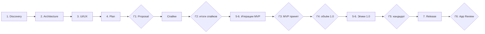

# Product Proposal — Часть 4. Roadmap, риски, рекомендации

> Черновик для обсуждения, 27.10.2026. Имя продукта не утверждено: в тексте используется рабочее название **Carrel** (часть 1), в идентификаторах кода — плейсхолдер `AppName` (часть 3).
> Метки релизов те же, что в части 1: **MVP**, **1.0**, **Future**. Оценки даны в днях сфокусированной работы одного разработчика. Календарный срок зависит от того, сколько таких дней в неделе есть у владельца.

## 10. Roadmap разработки

### 10.1 Этапы работы

| Этап | Результат | Где лежит | Гейт |
|---|---|---|---|
| 1. Product Discovery | Название, концепция, сценарии, функции с приоритетами, состав MVP и 1.0, преимущества | Часть 1, `01-product.md` | Г1 |
| 2. Product Architecture | Стек, слои и модули, ADR, модель данных, бюджеты производительности, тестирование, структура проекта, CI | Часть 3, `03-architecture.md` | Г1 |
| 3. UI/UX | Три настроения с макетами, рекомендация, ключевые экраны и принципы движения | Часть 2 | Г1 |
| 4. Implementation Plan | Итерации MVP, эпики 1.0, процесс, риски, монетизация | Часть 4, этот документ | Г1 |
| 5. Development | Код по итерациям, отчёты спайков в `docs/spikes/`, решения в `docs/adr/`, `CHANGELOG.md` | Репозиторий | Г2, Г3 |
| 6. Quality Assurance | Ручной чек-лист 8.8, замеры бюджетов 8.5 на iPad Air, учения по сбоям из 8.6, бета с 5–10 студентами | Issue релиза, `docs/performance.md`, TestFlight | Г5 |
| 7. Release Preparation | Запись в App Store Connect, метаданные, скриншоты, политика конфиденциальности, ответы App Privacy и age rating, заметки для App Review | App Store Connect, сайт | Г6 |

Этапы 1–4 закрывает этот Proposal. Код не пишется до Г1: архитектура и план без утверждённого объёма продукта меняются слишком дорого. Этапы 5–7 повторяются для каждого релиза. MVP проходит 5 и 6 (в App Store он не выходит), 1.0 — все три. QA не откладывается на конец: у каждой итерации есть свои критерии (10.2), а этап 6 — это приёмка релиза целиком.



| Гейт | Что решаем | Кто и на чём основании |
|---|---|---|
| Г1. Proposal одобрен | Рабочее имя, настроение интерфейса, минимальная iPadOS, тулчейн Xcode 27, ответы на открытые вопросы частей 1–4 | Владелец, по документам |
| Г2. Итоги спайков | Режим зума, подтверждённое окно автосохранения, правила для времени штрихов, судьба поиска по рукописи на русском и на iPadOS 26. Каждое решение оформляется ADR | Владелец, по отчётам с цифрами |
| Г3. MVP принят | Две недели лекций только в приложении без возврата в Goodnotes (критерий из 4.12) | Владелец, по собственному опыту |
| Г4. Объём 1.0 зафиксирован | Итоги интервью со студентами; вступление в Developer Program; порядок сокращения из 4.13 | Владелец |
| Г5. Релиз-кандидат | Чек-лист 8.8 пройден, бюджеты 8.5 выполнены, бета закрыта без блокеров, синхронизация отработала внутреннюю обкатку | Владелец, по отчёту QA |
| Г6. Отправка на ревью | Метаданные, приватность, age rating, заметки для App Review | Владелец |

**Что нужно от владельца для Г1:** рабочее имя (Carrel или Sheaf); выбор настроения из части 2; минимальная iPadOS и сборка в Xcode 27; модель iPad Air и версия iPadOS на нём; Mac, на котором идёт Xcode 27; держатель копирайта в `LICENSE` (сейчас «Devlet Boltaev», в брифе — «devlet.dev»); выпрямление фигур в MVP или в 1.0; минимальное восстановление из резервной копии в MVP (И7); срок вступления в Developer Program; наличие второго устройства для проверки синхронизации; сколько дней в неделю уходит на проект.

### 10.2 Итерации MVP

Правила плана:

- **Сначала риск.** Всё, что может перечеркнуть архитектуру (PencilKit на 60 Гц, сохранность при сбое, распознавание кириллицы), проверяется спайками до продуктовых экранов. Если провал случится, то в первую неделю, а не в последнюю.
- **Каждая итерация оставляет `main` рабочим** и устанавливаемым на iPad. Наполовину готовая функция прячется за Debug-флагом, а не живёт в ветке.
- **Атмосфера внутри каждой итерации.** Токены цвета, типографики и движения появляются в И1, и каждый новый экран сразу делается в выбранном настроении. «Полировки в конце» нет.
- **Одна итерация — один GitHub issue** с объёмом и чек-листом общих критериев, в milestone `MVP`.
- Код, написанный без Mac, проверяет только CI. Всё, что требует устройства, проверяет владелец по ручному чек-листу.

**Общие критерии готовности** действуют для каждой итерации. В описаниях ниже перечислено только то, что к ним добавляется.

| Критерий | Как проверяем |
|---|---|
| CI зелёный | `lint.yml` на `ubuntu-24.04` и `ci.yml` на `xcode-27` для последнего коммита итерации |
| Новая логика покрыта тестами | Swift Testing в `AppNameKit` (`swift test`) или в `AppNameTests` для адаптеров |
| Ключевой сценарий покрыт UI-тестом | XCTest в плане `UI`, хотя бы один зелёный прогон `nightly.yml` |
| Ручная проверка на устройстве | Пункты чек-листа 8.8, которые затрагивает итерация, на iPad Air + Pencil Pro; короткая запись экрана в issue |
| Доступность | VoiceOver-метки у новых элементов, Dynamic Type, вариант для Reduce Motion у каждой новой анимации, Increase Contrast |
| Нет сценария потери данных | Если итерация трогает данные: прерывание посреди операции проверено тестом или руками, ни один путь не удаляет файлы пользователя мимо Корзины |
| Документация | Строки в String Catalog, запись в `CHANGELOG.md` (`Unreleased`), ADR для нетривиального решения |

| № | Итерация | Дней | Риск или боль, которую закрывает |
|---|---|---|---|
| И0 | Фундамент репозитория и инструментов | 2–3 | Хаос в процессе, сборка «только у автора» |
| И1 | Walking skeleton | 2–3 | Нестыковки слоёв, CI без реального кода |
| И2 | Спайк S1: задержка, зум, пул канвасов | 3 | Главный технический риск (ADR-05) |
| И3 | Спайк S6: сохранность страниц и S3: время штрихов | 2 | Потеря данных; точность будущего аудио |
| И4 | Спайки S2 и S5: кириллица и FTS5 | 2 | Обещание поиска по рукописи |
| И5 | Хранилище тетради | 3 | Потеря данных |
| И6 | Библиотека и организация | 3 | Слабая организация |
| И7 | Снимки и резервная копия | 2 | Потеря данных при удалении приложения |
| И8 | Редактор: прокрутка и пул канвасов | 3 | Скорость на больших тетрадях |
| И9 | Перья и панель инструментов | 2–3 | Перегруженный интерфейс |
| И10 | Отмена, лассо, линейка | 2 | Потеря истории правок при подмене канваса |
| И11 | Apple Pencil Pro | 2 | Меню вместо инструмента под рукой |
| И12 | Выпрямление фигур | 3 | Собственная надстройка над PencilKit |
| И13 | Бумага и страницы | 3 | Потеря страницы при переносе |
| И14 | Изображения | 2–3 | Рост памяти и размера тетради |
| И15 | Экспорт | 2 | Данные заперты в приложении |
| И16 | Поиск по названиям и быстрая заметка | 2 | Слабый поиск |
| И17 | Обложки и открытие тетради | 3 | Непривлекательный интерфейс |
| И18 | Доступность и система | 2–3 | Приложение недоступно части пользователей |
| И19 | Производительность и учения по сбоям | 2–3 | Бюджеты без замеров |
| И20 | Обкатка MVP | 2 недели | Критерий MVP |

Итого около 45–55 дней сфокусированной работы плюс две недели обкатки. Это оценка до спайков; после Г2 план пересчитывается.

#### И0. Фундамент репозитория и инструментов

- **Цель.** Любой разработчик за 10 минут клонирует репозиторий, собирает пустое приложение и понимает правила. CI ловит ошибки раньше, чем сборка попадёт на iPad.
- **Объём.**
  - Владелец создаёт в Xcode 27 пустой проект `AppName` (iPad, iPadOS 26.0) — около 5 минут на Mac. Дальше всё правится как текст: folder-synchronized groups, `Config/*.xcconfig`, Info.plist и entitlements в `Config/`, пакет `Packages/AppNameKit` с пустыми `NotebookDomain`, `NotebookData` и их тестами (раздел 9).
  - Разные bundle ID для Debug (`dev.devlet.AppName.dev`) и Release (`dev.devlet.AppName`). Эксперименты и дневная сборка живут в разных контейнерах, поэтому отладка никогда не трогает настоящие конспекты. Отдельных приложений для спайков не заводим: у бесплатной команды ограничено число приложений на устройстве (по памяти — три; уточняем при настройке).
  - `lint.yml`, `ci.yml`, `nightly.yml`, `Scripts/lint.sh`, `Scripts/test.sh`, `.swift-format`, `.githooks/commit-msg`, `.gitattributes`, тест-планы `Unit`, `UI`, `Sanitizers`.
  - Документы: `README.md` (что это, тулчейн, как запустить), `CONTRIBUTING.md` (тулчейн, хук, команды, правила из 10.5), `CHANGELOG.md`, `ARCHITECTURE.md` (карта слоёв и модулей на одну страницу со ссылками на часть 3), `SECURITY.md`, `docs/adr/` с шаблоном и `0001-adopt-proposal-architecture.md`, который принимает ADR-01…ADR-15 из части 3. Шаблоны issue и PR, `CODEOWNERS`, `dependabot.yml`. `ARCHITECTURE.md` и `CHANGELOG.md` дополняют дерево из раздела 9.
  - Настройки GitHub: ruleset на `main`, запрещающий force push и удаление; secret scanning с push protection; Dependabot alerts; приватные сообщения об уязвимостях.
- **Готово, когда:** пустое приложение собирается в CI и ставится на iPad из Xcode; `swift test` пакета проходит; на ветке `spike/ci-selfcheck` при ручном запуске lint падает на неотформатированном файле и на сообщении коммита не по формату (после проверки ветка удаляется); инструкция из README воспроизводится на чистом клоне.

#### И1. Walking skeleton

- **Цель.** Тонкий сквозной путь через все слои: библиотека → новая тетрадь → письмо → сохранение в пакет → перезапуск → штрихи на месте.
- **Объём.** `AppNameApp`, `AppDependencies`, `AppDirectories` с `.temporary()`; минимальные `Notebook`, `Page`, `InkData`; `NotebookPackage` и `NotebookStore.saveInk` с настоящей атомарной заменой; библиотека простым списком; одна страница с `PKCanvasView` в `NotebookCanvasViewController`, `maximumSupportedContentVersion = .version4`; сохранение на `.inactive`; первые токены `DesignSystem` из выбранного настроения; `Localizable.xcstrings`; `PrivacyInfo.xcprivacy` с `NSPrivacyTracking = false`.
- **Готово, когда:** UI-тест «создать тетрадь → штрих пальцем (Debug `.anyInput`) → перезапуск → штрих на месте» зелёный; на iPad штрихи Pencil Pro переживают закрытие из переключателя приложений; round-trip пакета покрыт тестом в `NotebookDataTests`. Этой сборкой владелец пишет эталонные страницы для И4.

#### И2. Спайк S1: задержка, зум и пул канвасов

- **Цель.** До продуктовых экранов узнать, выдерживает ли PencilKit наш редактор на iPad Air 60 Гц. Это главный технический риск проекта (ADR-05).
- **Объём.** Ветка `spike/s1-canvas-zoom`. Нагрузочная тетрадь на 300 плотных страниц из Debug-команды; зум через раскладку против постраничного режима; пул из трёх канвасов с подменой превью; подавление встроенного undo PencilKit и снимки `PKDrawing` для `UndoManager` (ADR-06); съёмка письма на 240 fps рядом с Apple Notes.
- **Готово, когда:** в `docs/spikes/s1-canvas-zoom.md` есть цифры по критериям S1: чёткость на 1–4x, нет мерцания при письме, 0 hitches при смене страниц, задержка на уровне Apple Notes, память undo-снимков. Режим зума выбран и записан в ADR. Код спайка в `main` не вливается: production-версия пишется в И8 с тестами.
- **Стоп-сигнал.** Если не проходит ни один режим, Г2 наступает досрочно, и владелец выбирает между постраничным режимом, сокращением объёма и собственным движком чернил.

#### И3. Спайк S6: сохранность страниц и S3: время штрихов

- **Цель.** Подтвердить на устройстве обещание «потеря не больше окна автосохранения» до того, как на нём построено всё остальное. S6 — новый спайк, он дополняет таблицу 8.3.
- **Объём.** Прототип `AutosavePolicy` и `replaceItemAt` с `.previous` на реальном томе iPad; завершение процесса в случайный момент (остановка из Xcode, закрытие из переключателя, Debug-команда `abort()` посреди замены файла); сброс под `beginBackgroundTask` на `.inactive`; замер кодирования и записи страницы на 500 КБ (бюджет ≤ 30 мс вне main) и объёма записи за час письма (≤ 250 МБ). S3: сохраняется ли `PKStrokePath.creationDate` после лассо, точечного ластика, копирования и вставки на iPadOS 26 и 27.
- **Готово, когда:** 50 случайных прерываний не дали ни одной повреждённой страницы, потеря не превысила окно; цифры в `docs/spikes/s6-crash-safe-saving.md` и `docs/spikes/s3-stroke-dates.md`. Если даты штрихов меняются, правило их восстановления записано в ADR, дополняющий ADR-09.

#### И4. Спайки S2 и S5: распознавание кириллицы и FTS5

- **Цель.** Узнать, есть ли у нас поиск по рукописи на русском, раньше, чем мы его пообещаем (4.7, 5.6). Сама функция выходит в 1.0, но от ответа зависит позиционирование.
- **Объём.** Эталонный набор: около 20 страниц настоящих конспектов владельца на русском, английском и смешанных строках, с формулами, примерно 1000 размеченных слов. Прогон `PKStrokeRecognizer` (iPadOS 27) и Vision `RecognizeTextRequest` по растру страницы (iPadOS 26) — только на устройстве, потому что симулятор кириллицу не распознаёт. Метрика — доля слов, найденных поиском по префиксу, отдельно для RU, EN и формул. S5: `PRAGMA compile_options` системной SQLite на 26 и 27 и запрос FTS5 на синтетических 50 тыс. страниц. Сами страницы в публичный репозиторий не попадают, только цифры.
- **Порог.** Предлагаем не меньше 80% найденных слов для RU и EN на почерке владельца; уточняем после первого прогона.
- **Готово, когда:** отчёты `docs/spikes/s2-handwriting-recognition.md` и `docs/spikes/s5-fts5.md` готовы, и на Г2 выбран один из трёх исходов. (а) RU проходит на 27 — поиск по рукописи остаётся в 1.0. (б) Vision на 26 не проходит — на 26 ищутся только названия, теги и текст PDF, как в части 1; реализация на Vision из ADR-10 не делается. (в) RU не проходит на 27 — пункт 5.6 снимается, рукопись ищется только на английском.
- **Зависимость.** Для `PKStrokeRecognizer` нужен iPad на iPadOS 27. После обновления устройства iPadOS 26 проверяется только на симуляторе в `nightly.yml`.

#### И5. Хранилище тетради

- **Цель.** Production-версия ADR-02 и ADR-03 по итогам S6.
- **Объём.** `InkEnvelope` (magic, версии, длина, SHA-256); актор `NotebookStore`; `EditorSession` с `AutosavePolicy`; немедленный сброс при смене страницы, закрытии, `.inactive` и memory warning — под `beginBackgroundTask`; цепочка восстановления `.ink` → `.ink.previous` → снимок → `Recovered/`; `notebook.json` схемы v1 с полями PDF-фона и записей звука и golden-фикстура v1; `NotebookStoreError` и `UserFacingIssue`; индикатор «Сохранено».
- **Готово, когда:** параметризованные тесты порчи (усечение, бит-флип, пустой файл, чужой magic, новая версия контента) зелёные; UI-тест с `terminate()` внутри окна автосохранения; пункт 8 ручного чек-листа пройден.

#### И6. Библиотека и организация

- **Цель.** Структура «семестр → курс → тетради» и удаление, которое нельзя сделать по ошибке.
- **Объём.** `LibraryStore` и `library.json`; вложенные папки; `SortKey`; сортировка по дате изменения, названию и дате создания; недавние и избранные; переименовать, дублировать, переместить; мягкое удаление и Корзина на 30 дней; «Входящие» с фиксированным UUID; производный `catalog.sqlite` без FTS. Сетка обложек пока с простыми цветными обложками.
- **Готово, когда:** UI-тест «папка → тетрадь → удалить → восстановить из Корзины»; тест пересборки каталога из пакетов; очистка Корзины — чистая функция с параметром `now`, и тест подтверждает, что до 30 дней файлы не трогаются; VoiceOver озвучивает название и дату тетради.

#### И7. Снимки и резервная копия

- **Цель.** Три уровня отката у каждой страницы и копия вне приложения, из которой можно восстановиться.
- **Объём.** APFS-клоны пакета на сеанс редактирования (5 сеансов и по снимку в день за 7 дней, ADR-04); `isExcludedFromBackup` для `Snapshots/` и `Index/`; ручная резервная копия всей библиотеки одним архивом в «Файлы»; дата последней копии в настройках.
- **Минимальное восстановление (предложение).** Команда «Восстановить библиотеку из копии» в разделе настроек для разработчика: текущая библиотека сначала уходит в `Recovered/`, затем подменяется содержимым архива. Полноценный импорт архива с выбором тетрадей остаётся в 1.0, как в части 1. Причина: копия, из которой нельзя восстановиться, не защищает, а до вступления в Developer Program удаление приложения стирает данные.
- **Готово, когда:** тест ротации снимков; учение на iPad: копия → удалить приложение → установить заново → восстановить → все тетради открываются. Учение повторяется перед Г3.

#### И8. Редактор: прокрутка и пул канвасов

- **Цель.** Production-редактор по итогам S1: скорость не зависит от длины тетради.
- **Объём.** `NotebookCanvasViewController` с вертикальной прокруткой и пулом не больше трёх `PKCanvasView`; превью невидимых страниц и предекодирование соседней; масштаб пальцами и уровни «по ширине» и «страница целиком» по ADR из S1; открытие на последнем месте; переход к странице по номеру; новая страница при прокрутке за последнюю; `ThumbnailRenderer`; `EditorSessionRegistry`.
- **Готово, когда:** на нагрузочной тетради нет пустых страниц при быстром листании (пункты 6–7 чек-листа); интервал `notebook.open` укладывается в бюджет 8.5; UI-тест открытия на последнем месте.

#### И9. Перья и панель инструментов

- **Цель.** Спокойная панель письма: нужное перо — одним касанием, бумага — почти весь экран.
- **Объём.** Ручка, монолиния, перьевая ручка, карандаш, маркер; цвет и толщина; 3–5 избранных перьев; палитры, включая набор «Учёба»; ластик по штрихам и точечный; панель не больше семи элементов; положение панели и режим для левой руки. Liquid Glass — только у плавающих элементов, никогда над бумагой.
- **Готово, когда:** на скриншоте открытой тетради бумага занимает не меньше 90% экрана (принцип 1 из 2.2); инструменты доступны с клавиатуры и через VoiceOver; выбранное перо переживает перезапуск.

#### И10. Отмена, лассо, линейка

- **Цель.** Ошибаться без страха и править компоновку без переписывания.
- **Объём.** `UndoManager` на сеанс (ADR-06); касание двумя пальцами — отмена, тремя — повтор; ⌘Z и ⇧⌘Z; кнопки на панели; лассо PencilKit (переместить, масштабировать, копировать, удалить); линейка; правило ADR-09: любое программное преобразование штриха сохраняет исходную `creationDate`.
- **Готово, когда:** тест подтверждает, что отмена работает после переиспользования канваса из пула; тест сохранения `creationDate` при преобразовании; жесты проверены вручную на iPad.

#### И11. Apple Pencil Pro

- **Цель.** Сменить инструмент, не отводя взгляд от строки.
- **Объём.** Сжатие открывает палитру у кончика пера (`UIPencilInteraction`) с учётом системной настройки; двойное касание; barrel roll; тактильный отклик при прилипании к линейке; Apple Pencil 2 и Apple Pencil (USB-C) без функций, которых у них нет; рисование пальцем по настройке «Только Apple Pencil».
- **Готово, когда:** пункты 2, 3 и 5 ручного чек-листа пройдены; с Reduce Motion палитра появляется без движения.

#### И12. Выпрямление фигур

- **Цель.** Аккуратные схемы и графики по удержанию пера. Это единственная крупная собственная надстройка над PencilKit в MVP, и у PencilKit нет для неё публичного API.
- **Объём.** Распознавание удержания в конце штриха; подбор линии, стрелки, прямоугольника или эллипса; замена штриха построенным `PKStroke` с исходной `creationDate`; отмена возвращает исходный штрих; тактильный отклик Pencil Pro.
- **Гейт внутри итерации.** Если после первого дня ложные срабатывания или задержка заметны на 60 Гц, фигуры переходят в 1.0, а в MVP остаётся линейка.
- **Готово, когда:** классификатор покрыт тестами на записанных штрихах-фикстурах; не больше одного ложного срабатывания на 50 обычных штрихов; на iPad владелец рисует схему и график, и выпрямление срабатывает только там, где он его ждал.

#### И13. Бумага и страницы

- **Цель.** Управлять тетрадью как бумажной: своя бумага, порядок страниц, разбор «Входящих».
- **Объём.** Чистая, линейка узкая и широкая, клетка 5 мм, точки — в белом, кремовом и тёмном тоне; A4 и Letter, книжная и альбомная; смена бумаги у страницы и у тетради; в сетке миниатюр — добавить, удалить, дублировать, переставить; переместить или скопировать страницу в другую тетрадь, включая «Входящие».
- **Готово, когда:** UI-тест операций со страницами; перенос между тетрадями идёт в порядке «записать в целевую → мягко удалить в исходной», и тест подтверждает, что сбой посередине даёт дубликат, а не потерю; цвета чернил читаются на тёмной бумаге и с Increase Contrast.

#### И14. Изображения

- **Цель.** Фото доски и схема из учебника прямо в конспекте без роста памяти.
- **Объём.** Вставка из «Фото» (`PHPickerViewController`, без запроса доступа к медиатеке), «Файлов», камеры, буфера обмена и перетаскиванием; HEIC-ассеты по SHA-256 с длинной стороной до 4096 px (ADR-07); перемещение, масштаб, поворот; слой под чернилами; `NSCameraUsageDescription` в `InfoPlist.xcstrings`.
- **Готово, когда:** тест подтверждает, что дубликат изображения не занимает места; очистка неиспользуемых ассетов учитывает страницы в Корзине; 20 изображений на странице не дают hitches при письме.

#### И15. Экспорт

- **Цель.** Конспект можно сдать, отправить и распечатать; данные не заперты в приложении.
- **Объём.** PDF тетради, страницы и диапазона, с бумагой или без; изображение страницы; системный лист «Поделиться». Вектор или растр выбираем по замеру качества и размера файла.
- **Готово, когда:** экспорт тетради на 300 страниц идёт в фоне, отменяется и не блокирует письмо; тест подтверждает, что экспорт не меняет пакет; результат открывается в «Файлах» и печатается.

#### И16. Поиск по названиям и быстрая заметка

- **Цель.** Найти тетрадь за секунду и записать мысль за две.
- **Объём.** FTS-таблица каталога по названиям тетрадей и папок с нормализацией регистра, диакритики и `ё → е`; экран поиска; «Быстрая заметка» открывает новую страницу во «Входящих» сразу в режиме письма; команды меню и сочетания клавиш для новых действий.
- **Готово, когда:** тесты нормализации; UI-тест поиска; первые результаты не дольше 150 мс на синтетической библиотеке (performance-тест в пакете).

#### И17. Обложки и открытие тетради

- **Цель.** Моменты, которые владелец видит каждый день и по которым судит об атмосфере: полка с обложками и открытие тетради.
- **Объём.** Около 12 обложек выбранного настроения с цветовыми вариантами и надписью; переход «обложка → страница» и обратно; светлая и тёмная тема; для каждой анимации — вариант Reduce Motion, для стекла — Reduce Transparency.
- **Готово, когда:** переходы держат 60 кадров/с на iPad Air по Animation Hitches в Instruments; с Reduce Motion движение заменено кроссфейдом; запись экрана приложена к issue итерации.

#### И18. Доступность и система

- **Цель.** Приложение удобно с VoiceOver, крупным шрифтом, клавиатурой и в окне любого размера.
- **Объём.** Dynamic Type в библиотеке, меню и настройках; VoiceOver для библиотеки, навигации и инструментов; полный набор команд в строке меню; указатель и трекпад; окна любого размера и Stage Manager; два окна одной тетради делят сеанс.
- **Готово, когда:** UI-тест VoiceOver через `XCUIVoiceOverService`; конфигурация с псевдолокализацией двойной длины проходит без обрезанных строк; пункты 10–11 ручного чек-листа пройдены.

#### И19. Производительность и учения по сбоям

- **Цель.** Подтвердить цифрами и учениями обещания скорости и сохранности до того, как владелец доверит приложению лекции.
- **Объём.** Замеры всех бюджетов 8.5 на iPad Air с записью в `docs/performance.md`; performance-тесты XCTest (запуск, открытие 300 страниц, скролл, память); MetricKit в локальный журнал с отправкой через «Поделиться»; учения из 8.6: заполненный диск, повреждённый файл страницы и `notebook.json`, удалённый каталог, схема новее приложения.
- **Готово, когда:** каждый бюджет выполнен или на него есть issue с планом; каждый сценарий 8.6 воспроизведён и даёт описанную реакцию; час непрерывного письма без замедления и перегрева (пункт 14).

#### И20. Обкатка MVP

- **Цель.** Критерий MVP из 4.12.
- **Объём.** Владелец ведёт все лекции только в Release-сборке. Резервная копия — раз в неделю. Переустановка из Xcode — раз в 7 дней, пока профиль бесплатный; установка поверх данные сохраняет. Каждый дефект — issue; исправления идут обычными коммитами в `main` и попадают на iPad только после зелёного CI.
- **Готово, когда:** две недели без возврата в Goodnotes и без единой потерянной страницы; нет открытых issue с метками `data-loss` и `blocker`; тег `v0.1.0` и запись в `CHANGELOG.md`. Это Г3.

### 10.3 Релиз 1.0

**Условия старта.** Г3 пройден. Вступление в Apple Developer Program рекомендуем сразу после Г3: без него нельзя разрабатывать синхронизацию на устройстве, запускать TestFlight и резервировать имя в App Store Connect, а синхронизации нужна долгая внутренняя обкатка. На Г4 объём фиксируется по итогам интервью с 5–10 студентами (лекционный макет, режим повторения, выключенный по умолчанию ИИ).

**Порядок эпиков** выбран так, чтобы самое рискованное началось рано, а обкатка синхронизации шла параллельно с остальной работой. «Сохранность+» идёт раньше синхронизации: до того как синхронизация впервые тронет данные, у пользователя должна быть независимая копия.

| Эпик | Итерации | Дней | Гейты и зависимости | Режется? |
|---|---|---|---|---|
| Э1. Организация | Теги на тетрадях и страницах, поиск по тегам; архив семестра и вид списком | 5 | — | Нет |
| Э2. PDF | Импорт из «Файлов», «Поделиться» и перетаскиванием, копия в `assets/`; конвейер `CGPDFPage` в `CATiledLayer` с общим зумом (ADR-08); пометки и экспорт с прожжёнными чернилами; лекционный макет; извлечение текста и поиск по нему; вставка страниц PDF, свои шаблоны из PDF, переход с Goodnotes и Notability через PDF | 14 | PDF на 1000 страниц открывается быстрее 1 с; тест подтверждает, что хэш исходного файла не меняется | Нет |
| Э3. Аудио | Спайк S4; запись сегментами CAF в фоне; прерывания и смена наушников; индикатор уровня и предупреждение о тишине; «тапни штрих — услышь» (ADR-09); воспроизведение, скорость, перемотка; AAC после остановки; место на диске | 12 | S4: после аварийного завершения все сегменты воспроизводятся, потеря не больше 1 с; `NSMicrophoneUsageDescription` | Нет |
| Э4. Сохранность+ | История версий из снимков (страница или тетрадь); автокопия в выбранную папку; открытый формат экспорта со спецификацией в `docs/format/`; импорт архива | 7 | Формат экспорта читается тестом без PencilKit (JSON и точки штрихов) | Нет |
| Э5. Синхронизация iCloud | Модуль `NotebookSync`; `CKSyncEngine`, зона на тетрадь, записи и `CKAsset`; трёхсторонний merge штрихов как чистая функция с тестами без CloudKit; «конфликтная копия»; удаления в Корзину; квота и смена аккаунта; первая синхронизация большой библиотеки | 20 | Только после вступления в Developer Program; второе устройство; затем 4–6 недель внутренней обкатки на двух устройствах до Г5 | Нет |
| Э6. Поиск по рукописи | `HandwritingRecognizer`, `SearchIndexer`, кэш `text/`; подсветка, поиск в тетради, копирование как текста; Spotlight | 9 | Исход S2 на Г2; рукопись — только iPadOS 27+ | Нет |
| Э7. Учёба | Лента и режим повторения; бумага Корнелла | 5 | — | Лента — да, последней из режущихся |
| Э8. Письмо, изображения, навигация | Художественные чернила; лассо для штрихов и изображений, смена цвета выделенного; треугольники, многоугольники, таблицы; обрезка; сканирование документов (VisionKit); горизонтальное перелистывание; закладки | 10 | API выделения PencilKit — за `if #available(iPadOS 27, *)` | Чернила и закладки — да |
| Э9. Pencil Pro и персонализация | Предпросмотр при наведении, свои действия; обложки из фото; настроения интерфейса; вечерняя теплота; атмосфера стола; альтернативные иконки | 9 | Настроения — из части 2 | Атмосфера стола и иконки — первыми |
| Э10. Система | Окно на тетрадь; «Открыть в…» через `CFBundleDocumentTypes` без Share Extension (расширение потребовало бы App Group и `NSFileCoordinator`, см. 8.9); Shortcuts и App Intents; «Быстрая заметка» в Пункте управления | 7 | — | Нет |
| Э11. Подготовка к App Store | См. ниже | 6 + бета | Developer Program; Xcode Cloud | Нет |

Итого около 100–110 дней сфокусированной работы. Для одного разработчика это много, и часть 1 это признаёт. Порядок сокращения не меняется: атмосфера стола и иконки → художественные чернила → закладки → лента. PDF, аудио, синхронизация, история версий и поиск не режутся.

**Э11. Подготовка к App Store.**

- **Сразу после вступления в программу:** запись приложения в App Store Connect (резерв имени); проверка товарного знака по чек-листу 1.6 до финальной иконки; workflow Xcode Cloud по тегу `v*`.
- **Приватность:** аудит `PrivacyInfo.xcprivacy` (`CA92.1`, `C617.1`, `3B52.1`, `E174.1` — только реально вызываемые API); ответы App Privacy. Для 1.0 ожидаем «Data Not Collected»: аналитики и ИИ нет, синхронизация идёт через приватную базу CloudKit пользователя, к которой у нас нет доступа. Формулировку сверяем с правилами Apple перед отправкой. `ITSAppUsesNonExemptEncryption = NO`.
- **Обязательные страницы:** политика конфиденциальности и страница поддержки на `carrel.devlet.dev` (GitHub Pages, $0).
- **Анкеты:** age rating по новой системе (ожидаем 4+); Accessibility Nutrition Labels — заявляем только то, что проверено на устройстве: VoiceOver, Larger Text, Dark Interface, Sufficient Contrast, Reduced Motion.
- **Витрина:** подзаголовок «Handwritten Notes», описание и ключевые слова на английском, скриншоты для 13-дюймового iPad, превью-видео с открытием тетради. Доступность iPad-приложения на Mac с Apple silicon в App Store Connect выключаем, пока не проверим сценарий без пера.
- **Бета:** внутренний TestFlight, затем внешний для 5–10 студентов (первая внешняя сборка проходит Beta App Review), не меньше двух недель.
- **Заметки для App Review:** где лежит пример тетради, как проверить импорт PDF и запись звука.

**Критерии 1.0 (Г5):** все неурезаемые эпики закрыты; ручной чек-лист 8.8 пройден на iPad Air; бюджеты 8.5 выполнены; синхронизация прошла 4–6 недель обкатки на двух устройствах без потерь; бета закрыта без открытых `blocker` и `data-loss`; тег `v1.0.0`.

**Необязательный ИИ-модуль — первым после 1.0 (1.1), не в 1.0.** Часть 1 относит ИИ к Future, и план это сохраняет по трём причинам. Первое ревью проходит без риска отказа по Guideline 3.1.1 из-за ключа пользователя: отказ из-за ИИ не задержит PDF, аудио и синхронизацию. Ни один сценарий 1.0 не требует ИИ. Для русского текста, основного у аудитории, работает только OpenAI, которого многие не смогут оплатить. Объём 1.1 — 3–4 итерации: модуль `NotebookAssistant` с `AssistantProvider` и `AssistantRouter` (ADR-12), главный переключатель, экран согласия по 5.1.2(i), ключ в Keychain; первая функция — обложка по описанию через системный лист Image Playground или OpenAI. Вместе с ним обновляем ответы App Privacy («Other User Content» для OpenAI) и age rating с учётом вывода модели.

### 10.4 Будущие релизы

| Тема | Что входит | Когда берём в работу |
|---|---|---|
| ИИ (1.1 и дальше) | Обложки; название и теги; краткий конспект; вопросы по конспекту; перевод RU ↔ EN; транскрипция аудио; формула → LaTeX — только после прототипа | Сразу после 1.0, по одной функции за релиз |
| Учёба | Карточки из своего почерка с повторением по FSRS на устройстве; ИИ-вопросы как дополнение | Когда лента и режим повторения подтвердят спрос |
| Организация и поиск | Умные подборки; оглавление из рукописных заголовков; исправление распознанного текста; фильтры поиска | После того как поиск по рукописи наберёт статистику использования |
| Письмо | Текстовые блоки; шаблоны дневника и планера; растущая страница; слои — только при подтверждённом спросе | По запросам в issues и отзывах |
| Аудио | Воспроизведение с повтором письма | После стабилизации аудио в 1.0 |
| Платформа | Виджеты, Handoff, Mac, русская локализация, звуки бумаги | См. раздел 12 |
| Технический долг | Минимальная iPadOS 27: удалить путь Vision, поднять потолок версии контента, стабильные ID штрихов упростят merge и аудио | Когда доля iPadOS 26 у пользователей станет незначительной |

### 10.5 Процесс разработки

**Git.** По решению владельца коммиты идут прямо в `main`. Для одного разработчика это быстрее PR: каждый push проверяет CI, история остаётся линейной. Правила:

- Один коммит — одна логическая правка, и каждый коммит собирается. На это опирается `git bisect`, а при push нескольких коммитов CI проверяет только последний.
- Перед push — `git pull --rebase`; merge-коммитов в `main` нет.
- Внешние вклады приходят через PR из форков и вливаются rebase, чтобы история оставалась линейной. CI на `pull_request` уже настроен.

**Conventional Commits 1.0.** Формат `type(scope): summary`: английский, повелительное наклонение, не длиннее 72 символов.

| Тип | Когда |
|---|---|
| `feat`, `fix`, `perf` | Изменение, заметное пользователю; обязательна запись в `CHANGELOG.md` |
| `refactor`, `test`, `style` | Код без изменения поведения |
| `docs`, `build`, `ci`, `chore` | Документы, проект и xcconfig, workflows, обслуживание |
| `revert` | Откат коммита, в том числе при красном `main` |

Области: `library`, `editor`, `ink`, `storage`, `search`, `export`, `pdf`, `audio`, `sync`, `assistant`, `design`, `a11y`, `release`. Восклицательный знак после типа и футер `BREAKING CHANGE:` ставятся только при изменении формата хранения, которое старые версии не прочитают (новая `schemaVersion`), или при удалении функции.

```text
feat(editor): snap held strokes to lines and ellipses
fix(storage): keep the previous ink generation when replacement fails
perf(library): render cover thumbnails off the main actor
```

Формат проверяют локальный хук `.githooks/commit-msg` (включается один раз: `git config core.hooksPath .githooks`) и `lint.yml` на диапазоне push. Запретить push с неправильным сообщением на сервере может только GitHub Enterprise, поэтому CI здесь сигнал, а не барьер. Dependabot настроен с префиксом `ci`.

**Версии и теги.** SemVer 2.0, аннотированные теги `vMAJOR.MINOR.PATCH`. До 1.0 — `0.y.z`: `v0.1.0` — принятый MVP, далее MINOR за каждый закрытый эпик, PATCH — исправления. Сборки TestFlight-кандидатов помечаются тегом `v1.0.0-rc.N`, при этом `MARKETING_VERSION` остаётся `1.0.0`: App Store не принимает суффиксы в версии. `MARKETING_VERSION` задаётся в `AppName.xcconfig`, номер сборки для App Store — `CI_BUILD_NUMBER` из Xcode Cloud.

**CHANGELOG** в формате Keep a Changelog 1.1.0. Запись в `Unreleased` (Added, Changed, Deprecated, Removed, Fixed, Security) делается в том же коммите, что и изменение, и пишется языком пользователя. Релизный коммит `chore(release): 0.1.0` переносит `Unreleased` в раздел версии с датой и обновляет ссылки сравнения. Тег ставится на этот коммит.

```markdown
## [Unreleased]

### Added
- Hold the pencil at the end of a stroke to straighten it into a line, arrow, rectangle, or ellipse.

## [0.1.0] - YYYY-MM-DD
```

**`main` всегда зелёный.**

- Перед push запускаются `Scripts/lint.sh` и на Mac `Scripts/test.sh` (тесты пакета идут секунды). Коммиты, написанные без Mac, полностью полагаются на CI, поэтому делаются особенно маленькими.
- Красный `main` — главный приоритет. Поверх него идёт только исправление. Если причина не очевидна за 30 минут, виновный коммит откатывается через `git revert`, и работа продолжается локально.
- Нестабильный тест не перезапускается молча. Он помечается `.disabled("Flaky, see #N")` (в XCTest — `XCTSkip` со ссылкой на issue) и чинится в течение недели.
- Смена Xcode на раннере — отдельный коммит `ci: …` без других изменений. О падении workflow GitHub сам сообщает владельцу письмом; отдельных уведомлений не нужно.

**Ветки — исключение, а не правило.**

| Префикс | Когда | Как возвращается в `main` |
|---|---|---|
| `spike/<id>-<slug>`, например `spike/s1-canvas-zoom` | Код спайка или самопроверка CI | Никогда не вливается. В `main` попадает отчёт в `docs/spikes/` с нужными фрагментами кода, ветка удаляется |
| `release/<major.minor>`, например `release/1.0` | Версия на ревью или стабилизации, а в `main` уже идут изменения, которые не должны в неё попасть | Исправление делается в `main` и переносится через `git cherry-pick -x`; тег ставится на ветке; ветка удаляется после следующего MINOR |
| `hotfix/<version>-<slug>`, например `hotfix/1.0.1-ink-recovery` | Срочное исправление выпущенной версии при невыпускаемом `main` | Создаётся от тега; то же исправление обязательно попадает в `main`; PATCH-тег на ветке |

Для `release/**` и `hotfix/**` в `ci.yml` добавляется триггер `push`. Спайки собираются через ручной запуск workflow.

**Definition of Done для коммита.**

1. Собирается, проходит `swift format lint --strict`, содержит одну логическую правку.
2. Новая логика покрыта тестами: в пакете — Swift Testing, адаптеры — в `AppNameTests`.
3. Сообщение по Conventional Commits, без служебных трейлеров. Изменение, заметное пользователю, записано в `Unreleased`.
4. Пользовательские строки — в String Catalog; у новой анимации есть вариант для Reduce Motion.
5. Изменение формата хранения — новая `schemaVersion`, шаг миграции, golden-фикстура и `!` в типе коммита.
6. Нет `TODO` и `FIXME` без номера issue, `try!` и force unwrap в путях данных, секретов и ключей.
7. Имена следуют Swift API Design Guidelines; комментарии объясняют «почему», а не «что».
8. Если правка затрагивает сохранность, сценарий сбоя проверен тестом или описан ручным шагом в issue.

**Учёт работы.** GitHub Issues и milestones `MVP` и `1.0`. Метки: `data-loss`, `blocker`, `spike`, `a11y`, `perf`, `design`. Доска GitHub Projects — по желанию; для одного разработчика хватает milestones.

## 11. Основные технические риски

Вероятность и влияние оцениваются как низкие, средние или высокие. Столбец «Когда проверяем» ссылается на итерации из 10.2, эпики из 10.3 и гейты из 10.1.

| Риск | Вероятность | Влияние | Как снижаем | Когда проверяем |
|---|---|---|---|---|
| В рабочем контейнере нет Xcode и Swift: код нельзя собрать и запустить локально | Высокая (факт) | Среднее | Маленькие коммиты; быстрый lint на `ubuntu-24.04`; `swift test` пакета на хосте за секунды; всё, что требует устройства, — ручной чек-лист владельца | Каждая итерация |
| PencilKit: закрытый движок, нет своих кистей, стоимость растёт с числом штрихов, размытие и мерцание при зуме | Средняя | Высокое | Рисунок на страницу, пул ≤ 3 канвасов, зум по итогам S1; запасные пути — постраничный режим или собственный движок | И2, И8, И19 |
| Задержка пера ощутима на 60 Гц iPad Air | Средняя | Высокое | Системная отрисовка PencilKit; на main во время касания нет работы дольше 4 мс; индексация и анимации на паузе, пока перо на странице; съёмка 240 fps рядом с Apple Notes | И2, каждая итерация редактора |
| Качество распознавания кириллицы и формул | Высокая | Среднее | S2 на реальном почерке до обещаний; рукопись ищется только на iPadOS 27+; формулы → LaTeX только после прототипа; запасной путь — поиск по названиям, тегам и тексту PDF | И4, Э6 |
| Потеря данных | Низкая | Критическое | ADR-03 и ADR-04, цепочка восстановления, учения 8.6, Корзина, отдельный bundle ID для отладки, еженедельная копия | Каждая итерация, И19, Г3, Г5 |
| Миграции собственного формата (SwiftData не используем, ADR-01) | Средняя | Высокое | `schemaVersion`, миграция в памяти, golden-пакеты каждой версии, режим только для чтения для более новой схемы | Каждая смена формата |
| Совместимость чернил iPadOS 26 и 27 | Средняя | Высокое | Потолок `maximumSupportedContentVersion = .version4`, `requiredContentVersion` в конверте | И1, И5, nightly на iPadOS 26 |
| Время штрихов меняется при лассо и ластике | Средняя | Среднее | S3; правило сохранения `creationDate` в собственных преобразованиях | И3, И10 |
| Выпрямление фигур поверх PencilKit оказывается неточным или медленным | Средняя | Низкое | Гейт после первого дня И12; запасной вариант — только линейка в MVP | И12 |
| CloudKit недоступен без платной программы | Высокая (факт) | Высокое | Синхронизация после вступления в программу; готовность модели к синхронизации с MVP (ADR-11) | Г3, Г4 |
| Конфликты синхронизации и потеря данных при них | Средняя | Критическое | `CKSyncEngine`, merge на уровне страниц, «конфликтная копия», удаления в Корзину, независимая копия до синхронизации, 4–6 недель обкатки на двух устройствах | Э4, Э5, Г5 |
| Нет второго устройства для проверки синхронизации | Средняя | Высокое | Решить до Г4: второй iPad, Mac как запасной вариант или устройство студента из беты | Г4 |
| Бесплатный профиль истекает за 7 дней, удаление приложения стирает данные | Высокая | Среднее | Переустановка раз в неделю, резервная копия с проверенным восстановлением (И7), вступление в программу после Г3 | И7, И20 |
| Apple Intelligence без русского; модели доступны не на всех устройствах | Высокая (факт) | Низкое | ИИ необязателен; доступность модели и языка проверяется во время работы; для русского — только OpenAI | 1.1 |
| Отказ App Review из-за ИИ по ключу пользователя (3.1.1, прецедент 2024 года) | Средняя | Среднее | ИИ после 1.0; ключ ничего не открывает и ничего платного не даёт; согласие по 5.1.2(i); в заметках для ревью — демонстрация на моделях Apple | 1.1 |
| App Privacy и age rating с выводом OpenAI | Средняя | Низкое | Консервативное раскрытие «Other User Content», задачи модели ограничены конспектами | 1.1 |
| MIT позволяет законно выпустить клон, в том числе платный | Средняя | Среднее | Бренд вне MIT, товарный знак, присутствие и рейтинг в App Store, скорость развития (12.4) | До 1.0 |
| Пересечение имени с чужим товарным знаком | Средняя | Среднее | Чек-лист 1.6 части 1 до иконки и публичных материалов | Г1, Э11 |
| Образ `xcode-27` новый, на нём нет симулятора iPadOS 26 | Средняя | Среднее | `DEVELOPER_DIR` на точной версии Xcode; nightly-job со скачиванием рантайма iPadOS 26; следим за объявлениями runner-images | И0, при смене образов |
| Для S2 нужен iPad на iPadOS 27, после обновления iPadOS 26 на устройстве не проверить | Средняя | Среднее | Решение на Г1; 26 покрываем nightly-симулятором | Г1, И4 |
| Большие PDF тормозят | Средняя | Высокое | Собственный конвейер `CGPDFPage` в `CATiledLayer`, тест на PDF в 1000 страниц | Э2 |
| Падение или прерывание записи лекции | Средняя | Высокое | S4, сегменты CAF, реакция на звонки и смену наушников | Э3 |
| Расползание объёма | Высокая | Высокое | Критерий MVP, правило «новое вытесняет старое», порядок сокращения 1.0, список Future; любое добавление — issue с явным «вместо чего» | Каждое планирование итерации, Г2, Г4 |
| Пропускная способность одного разработчика; кривая освоения Swift, UIKit и PencilKit после Flutter | Высокая | Высокое | Маленькие итерации, автоматизация CI, ноль лишних инструментов, спайки в начале, порядок сокращения; пересчёт плана на Г2 и Г4 | Г2, Г4, раз в месяц |
| Apple меняет API (например, `ImageCreator` устарел в iPadOS 27) | Средняя | Среднее | Проверка `#available` во время работы, ADR на каждое принятое новое API, разбор WWDC каждый июнь | Ежегодно |

## 12. Рекомендации по дальнейшему развитию

### 12.1 Продукт

- **Mac — раньше iPhone.** Сначала iPad-приложение на Mac с Apple silicon: почти бесплатно и удобно для поиска и повторения за столом. Mac Catalyst или отдельный интерфейс — только при спросе. Пока сценарий без пера не проверен, доступность на Mac в App Store Connect выключена.
- **iPhone-компаньон — после стабильной синхронизации,** не раньше чем через три месяца после 1.0 без инцидентов. Его роль — просмотр, поиск, повторение по ленте и быстрая заметка во «Входящие»; полноценного письма на iPhone не делаем. Пакет `AppNameKit` уже объявляет iOS, поэтому домен и хранилище переиспользуются без изменений.
- **Обмен без совместного редактирования.** Сейчас — экспорт в PDF и открытый формат. Затем — отправка тетради одним файлом (архив пакета): получатель импортирует копию. Позже, при спросе, — просмотр по ссылке через `CKShare`: зона на тетрадь (ADR-11) это уже позволяет. Совместное редактирование не делаем (2.3).
- **Шаблоны.** Небольшой подобранный набор: Cornell, неделя, семестровый план. Шаблон — это тетрадь с фоном, отдельного движка нет. Маркетплейса нет.
- **Интервальное повторение.** Карточки, выделенные лассо из своего почерка, с планированием по FSRS на устройстве и очередью по курсам. Работает без ИИ и без сети, поэтому это главный учебный довод для русскоязычной аудитории.
- **Русская локализация.** Строки уже в String Catalog, стоимость перевода низкая, а основная аудитория говорит по-русски. Делаем в первом же релизе после 1.1.
- **Доступность как отличие.** Озвучивание рукописи через распознавание на iPadOS 27+, честно заполненные Accessibility Nutrition Labels.
- **Открытость.** Спецификация формата в `docs/format/`, задачи с меткой `good first issue`, публичный roadmap в milestones.

### 12.2 Техника

- **Поднять минимальную версию до iPadOS 27,** когда это позволит аудитория. Уходит путь Vision, поднимается потолок версии контента, стабильные ID штрихов упрощают merge и аудио, становится доступен API выделения.
- **Пересмотреть модули** при появлении второго разработчика, расширения (виджет, Share Extension) или медленной инкрементальной сборки (8.2).
- **Журнал на каждый штрих** — только если MetricKit или отзывы покажут реальные потери (ADR-03).
- **Собственный движок чернил** держим как долгосрочный вариант на случай, если PencilKit упрётся в потолок, но без сигнала его не начинаем.
- **Ежегодный цикл:** в июне — разбор WWDC и ADR на каждое принятое API; в сентябре — переход CI на новый мажорный Xcode отдельным коммитом.

### 12.3 Монетизация: варианты

Исходные условия. Код под MIT, поэтому любой может законно собрать и выпустить клон, в том числе платный. Защищают нас бренд и товарный знак, присутствие в App Store (рейтинг, отзывы, позиция в поиске), качество исполнения, скорость развития и доверие, которое даёт открытый код. Своих серверов нет, поэтому нет и постоянных расходов, которые пришлось бы перекладывать на пользователя. Оплата в App Store из России недоступна с апреля 2026 года.

| Модель | Как устроена | Плюсы | Минусы и риски | С учётом MIT |
|---|---|---|---|---|
| Бесплатно + донаты | Приложение бесплатное; чаевые через IAP (consumable); GitHub Sponsors — только вне приложения (README, сайт) | Максимальная аудитория и доверие, полностью соответствует принципу 5 | Доход небольшой и непредсказуемый; ссылки на внешние платежи внутри приложения ограничены Guideline 3.1.1, правила сверяем перед релизом | Клон не получает наших донатов: их приносит бренд, а не код |
| Разовая покупка приложения | Платная загрузка | Просто и честно; прецеденты — Noteful, Notability Classic | Цена отсекает студентов; в App Store нет пробного периода для платных приложений | Худший вариант: бесплатный клон из нашего кода прямо заменяет платный оригинал |
| Бесплатное ядро + разовые дополнения | Ядро бесплатно; платные наборы обложек, бумаги, настроений и атмосфер стола; разовый «Supporter» | Базовое бесплатно; платят те, кому важна атмосфера; StoreKit 2 уже в стеке | Нужен постоянный выпуск качественного контента; нельзя обеднять атмосферу по умолчанию. ИИ не продаём: пользователь уже платит OpenAI сам, а продажа функций рядом с ключом усиливает риск по 3.1.1 | Код наборов открыт, но их графика лицензируется отдельно (12.4), поэтому клон их не скопирует |
| Подписка только на функции с постоянными расходами | Подписка оплачивает конкретный сервер: например, ИИ без своего ключа или веб-ссылки на тетради | Честно: платят за реальную стоимость | Нужен бэкенд — это противоречит бюджету $0; сейчас таких функций нет | Серверная часть может быть закрытой и стать настоящим отличием от клона |

**Рекомендация.** 1.0 выходит бесплатным и без покупок: первое ревью проще, а аудитории и доверию нужно время. В 1.x добавляем бесплатное ядро с разовыми дополнениями и чаевыми — третью модель плюс IAP из первой. Ядро бесплатно навсегда и без подписки: неограниченные тетради, PDF, аудио, поиск, экспорт и синхронизация iCloud. Синхронизация стоит нам $0, потому что расходует квоту пользователя, а «никогда не терять заметку» нельзя продавать по подписке. Подписка появится, только если появится сервис с реальной стоимостью, и только на него. Paid Applications Agreement, налоговые формы и банковский счёт в поддерживаемой стране стоит проверить заранее: без них никакая модель не включится.

### 12.4 Бренд вне MIT

MIT не упоминает товарные знаки. Принято считать, что прав на имя он не даёт, но явное разделение снимает двусмысленность и делает претензию к клону исполнимой — например, через форму App Store Content Dispute.

1. **`LICENSE` (MIT) покрывает исходный код.** Держатель копирайта приводится к одному варианту: сейчас там «Devlet Boltaev», а в брифе — «devlet.dev». Решает владелец.
2. **`TRADEMARKS.md` в корне.** Имя, логотип и иконка — товарные знаки владельца, MIT на них не распространяется. Форк обязан сменить имя, иконку и брендовую графику до любой публикации. Описательное упоминание («основано на Carrel») разрешено.
3. **Брендовая графика лежит отдельно,** например в `AppName/Resources/Brand/`: иконка `AppIcon.icon`, обложки, художественные текстуры, графика настроений и атмосфер стола. На неё действует `LICENSE-ASSETS.md` в корне со списком путей и условием «все права защищены». Линовка и сетки бумаги рисуются кодом и остаются под MIT. `AppIcon.icon` при этом переезжает из `AppName/Resources/` (дерево раздела 9) в эту папку. Графика остаётся в публичном репозитории, поэтому любой участник собирает приложение без дополнительных шагов.
4. **В `CONTRIBUTING.md`** правило «входящий вклад = MIT» для кода, а изменения в `AppName/Resources/Brand/` принимаются только от владельца. CLA не нужен: MIT разрешает коммерческое использование вкладов, в том числе в платном приложении.
5. **Регистрация товарного знака** (USPTO и EUIPO, классы 9 и 42) стоит сотни долларов за класс и выходит за бюджет $0. Это решение владельца после проверки имени по чек-листу 1.6. До регистрации защищают запись в App Store Connect, домен, единообразное использование имени и знак ™.
